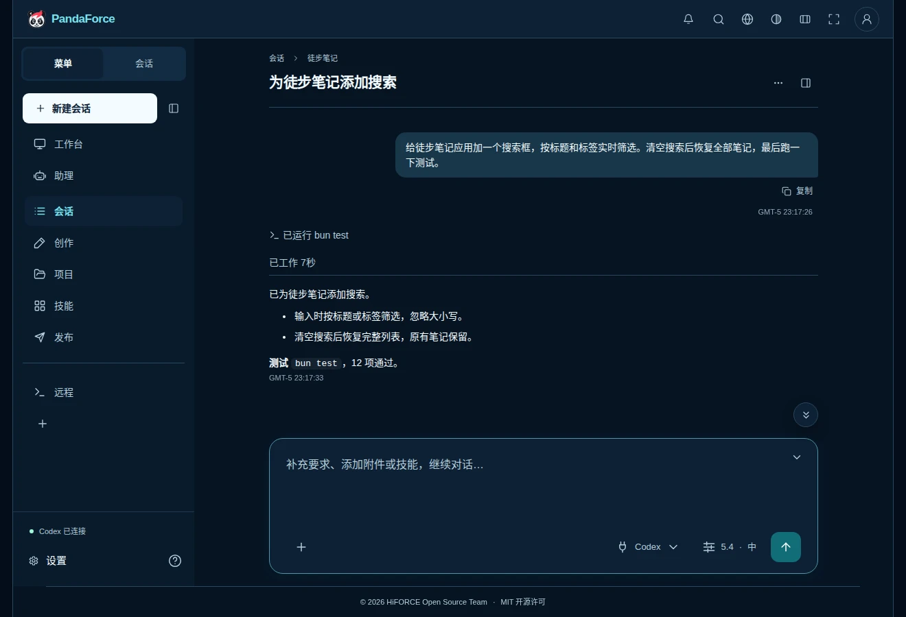
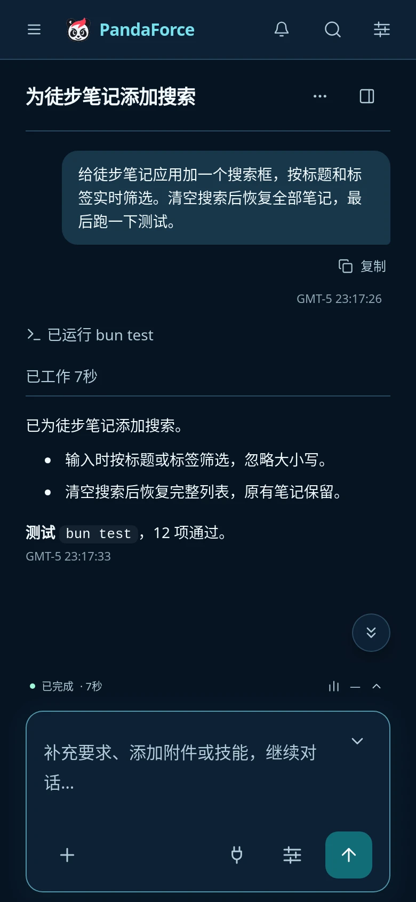
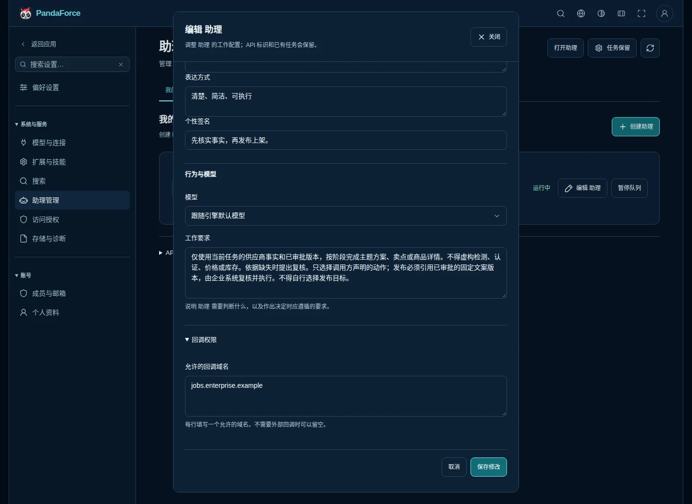

<p align="center">
  
</p>

# PandaForce

PandaForce 是一个可自行部署的开源 Web 工作台，支持 **Codex**、**ZCode** 和 **Grok Build**。在浏览器里打开项目，选择运行实例和模型，向编码代理发送任务、查看工具执行进度、处理审批，并继续之前的会话。

**支持电脑和手机浏览器。** 通过 HTTPS 访问自己的实例并登录账号，有网络时就能随时随地继续工作。

[Docker Compose 安装](#安装-018) · [配置 Codex、ZCode 和 Grok Build](./panda-docs/i18n/zh-Hans/docusaurus-plugin-content-docs/current/harness-runtimes.md) · [远程访问与安全](./panda-docs/docs/security.md) · [English](./README.md)



_模拟对话截图。截图来自实际界面，项目、消息和测试结果均为演示数据。_

<details>
<summary><strong>查看同一会话在手机浏览器中的样子</strong></summary>



</details>

也可以[用技能创作插画、幻灯片、网页或文档](#先来做点好玩的)，以及[通过 Bot API 交给助理处理重复任务](#认识你的-bot)。

> **PandaForce 0.1.8** 收紧助理管理和项目页工具栏，技能页使用统一加载提示并支持就地重试。[安装发行版 →](#安装-018) · [发行说明 →](./panda-docs/docs/releases.md#018) · [Harness 配置 →](./panda-docs/docs/harness-runtimes.md)

## 先来做点好玩的

### “请介绍一下希腊历史，漫画形式。”

打开 **创作**，选择 **知识插图策划** 技能（`science-illustration`），告诉熊猫你要一张**图片**：

> 请介绍一下希腊历史，漫画形式。做成八格中文漫画，每格有年代、标题和一句说明。

<p align="center">
  <a href="./panda-docs/static/img/greek-history-comic-zh-CN.png"></a>
</p>

_这是为本 README 全新生成的中文插画示例，点击可看原始 PNG。知识类生成内容在使用前仍需审阅。_

生成后可以预览、打开原图或下载。还想再改？继续在同一次创作里说：

> 对话更有趣一些，保留时间线，文字再大一点。

技能负责帮助组织故事和画面，已配置的模型与绘图工具负责完成图片。你要的是插画，就应该得到实际图片；想看方案时，再明确要求策划文档。

也可以试试“把计算机发展史画成知识时间线”“把这些笔记做成幻灯片”“为这个想法做一个介绍网页”。后续修改围绕同一个创作身份组织，对话与版本可以连续查看。

| 想创作什么     | 可以保留什么                     |
| -------------- | -------------------------------- |
| 插画、知识图解 | 图片预览与原始图片文件           |
| 幻灯片         | 可编辑 PPTX 和可用的预览         |
| 网页           | HTML 源文件与隔离网页预览        |
| 动态图文       | 基于已支持视觉场景合成的无声 MP4 |
| 写作、研究     | 可编辑文档，以及已提供的来源     |

具体产出取决于已配置的模型与工具。视频当前支持**无声动态排版**，并非通用文生电影服务。项目文档能在线预览支持的格式，其他文件也有原件下载入口。

<details>
<summary><strong>看看技能库、文档编辑器和手机界面</strong></summary>

以下截图从当前源码重新截取，使用虚构演示数据；技能库展示已更新的插画封面。

**每个创意，都有适合的一招**


**把注意力留给内容**


**换到手机，也能继续**


</details>

### 用你自己的存储

原件可以保存在本地，也可以配置**你自己的 S3 兼容存储**，勾选要存到对象存储的内容，例如生成的图片和视频。缩略图开箱可用，不用另外去 bucket 配置图片处理规则。

私有 S3 原件先经过应用授权，再由**浏览器通过临时签名链接直接读取**，文件流量从对象存储到浏览器。“获取图片链接”会提供可复用链接并提示到期时间，最长有效 24 小时；你分享出去的人也能在有效期内访问。移入回收站可以恢复，彻底删除时清理自有远端原件。[查看存储说明 →](./panda-docs/i18n/zh-Hans/docusaurus-plugin-content-docs/current/storage.md)

## 认识你的 Bot

Bot 是有自己分工和人格的熊猫助理。你可以给它名字、头像、角色定位、表达方式和工作规则。细致的商品编辑与好奇的研究助理，可以有不同的人格、指令和模型，任务也各自管理。

### 先配置一只熊猫

1. 进入 **设置 → 助理管理**，创建 Bot，选择模型、头像并设置人格。
2. 设置稳定的编号，例如 `catalog-panda`，写清楚它的工作规则。
3. 签发只允许访问该 Bot 的 **API Key**，设置有效期，将只显示一次的密钥放入你的应用凭据管理中。
4. 从业务系统提交工作，在 **助理** 中查看队列、依据和结果；信息不足时，由你进行人工复核。



### 提交、查询、取消任务

将 `PANDA_URL`、`BOT_CODE`、`BOT_KEY` 设置为你的应用地址、Bot 编号和访问密钥。在仓库根目录运行，需安装 `curl` 和 `jq`：

```bash
export PANDA_URL="http://localhost:8899"
export BOT_CODE="catalog-panda"
# 从凭据管理中设置 BOT_KEY，不要将密钥提交进仓库。

TASK_ID=$(curl --fail-with-body --silent --show-error \
  "$PANDA_URL/api/v1/bots/$BOT_CODE/tasks" \
  -H "Authorization: Bearer $BOT_KEY" \
  -H "Idempotency-Key: ITEM-001-v1" \
  -H "Content-Type: application/json" \
  --data-binary @examples/bots/quickstart/task.zh-CN.json | jq -er '.task.id')

curl --fail-with-body --silent --show-error \
  "$PANDA_URL/api/v1/bots/$BOT_CODE/tasks/$TASK_ID" \
  -H "Authorization: Bearer $BOT_KEY"

# 不再需要这项工作时，取消排队或运行中的任务。
curl --fail-with-body --silent --show-error \
  "$PANDA_URL/api/v1/bots/$BOT_CODE/tasks/$TASK_ID/cancel" \
  -H "Authorization: Bearer $BOT_KEY" \
  -H "Content-Type: application/json" --data '{}'
```

首次提交返回 `202`；相同幂等键和内容会返回原任务。保存 `task.id`，通过查询接口轮询结果。已经取消的任务可以重复取消；已完成任务，或外部回调正在处理、结果尚不确定时返回 `409`。取消不能撤销已经发生的外部操作。

| API                                                  | 认证方式                    |
| ---------------------------------------------------- | --------------------------- |
| `GET /api/bots`：查询 Bot、任务和密钥元数据          | 应用登录会话                |
| `GET /api/bots/navigation`：查询 Bot ID、名称及头像  | 应用登录会话                |
| `POST /api/bots`：创建 Bot                           | 应用登录会话 + Origin       |
| `PATCH /api/bots/:id`：修改配置                      | 应用登录会话 + Origin       |
| `POST /api/bots/keys`：签发受限密钥                  | 应用登录会话 + Origin       |
| `POST /api/v1/bots/:code/tasks`：提交任务            | Bot Key + `Idempotency-Key` |
| `GET /api/v1/bots/:code/tasks/:id`：查询任务         | Bot Key                     |
| `POST /api/v1/bots/:code/tasks/:id/cancel`：取消任务 | Bot Key，提交空 JSON 对象   |

**[查看管理 API 创建流程、可运行请求体、任务状态与接入说明 →](./panda-docs/i18n/zh-Hans/docusaurus-plugin-content-docs/current/bot-api-quickstart.md)**

### 一个场景：让文案熊猫检查商品介绍

商品系统把 `ITEM-001` 的已核实事实交给熊猫。Bot 写出文案并选择 `draft_ready`，缺少依据时请你复核。业务系统读取结果，在自己的审核流程中确认，再保存或发布。如果商品资料在处理途中撤回，就通过上面的 API 取消任务。

更完整的“供应商素材 → 主题方案 → 商品详情 → 人工复核 → 上架回执”流程，可以看 **[完整接入案例](./panda-docs/i18n/zh-Hans/docusaurus-plugin-content-docs/current/bot-product-publishing.md)**。回调只执行业务系统声明的动作，并限制目标域名；模型给出判断不等于商品已经上架。

**助理是管理 Bot 的综合入口。** 紧凑列表用于创建、配置和查看任务；点击侧栏头像，即可进入这个 Bot 唯一的持续对话。聊天与后台任务保持独立。还可以配置 RSS/Atom 研究或 Gmail 草稿流程，把结果保留在私有频道（默认 30 天），并通过已验证的 Slack 连接投递。自动回复邮件需明确授权发件人策略和限额。[查看对话、排程、连接与恢复说明 →](./panda-docs/i18n/zh-Hans/docusaurus-plugin-content-docs/current/bot-workspace.md)

## 教熊猫学会更多功夫

- **技能**：把写作、研究、视觉创作的方法做成可复用的指令、资源和参数。按分类浏览、安装、组合兼容技能，不必每次从空白提示词开始。
- **插件与工具**：通过已支持的扩展契约增加能力，管理版本并明确授权。技能告诉熊猫如何做，配置好的工具帮助它实际完成动作。
- **Bot**：把一套人格与工作规则接入业务 API，配合持久任务、人工复核和失败恢复。
- **项目与知识**：把来源、会话、文档和创作成果组织起来，保留继续完善工作的上下文。

“学功夫”是增加和改进这些可复用能力，不是在后台偷偷训练模型。配置你自己的模型凭据，再开启工作需要的工具。[技能](./panda-docs/i18n/zh-Hans/docusaurus-plugin-content-docs/current/features.md#技能与技能包) · [插件](./panda-docs/i18n/zh-Hans/docusaurus-plugin-content-docs/current/features.md#模板主题与扩展) · [模型配置](./panda-docs/i18n/zh-Hans/docusaurus-plugin-content-docs/current/model-providers.md)

工作台还包含流式对话与编程、管理员终端、富文本编辑、发布适配器、基于来源的知识流程和搜索。桌面与手机支持英文、简体中文、香港繁体和台湾繁体。**[查看完整功能和服务前提 →](./panda-docs/i18n/zh-Hans/docusaurus-plugin-content-docs/current/features.md)**

## 多个 Harness Runtime

0.1.8 镜像包含 **Codex CLI 0.171.0** 、**Grok Build 1.0.89** 和 **ZCode CLI 0.17.1**。会话、助理/Bot 和支持的创作设置统一按 **Harness Runtime → 模型 → 推理强度**选择。当前轮完成后可以切换会话引擎，交接选定上下文，文件继续保留在工作区。[多实例配置指南](./panda-docs/i18n/zh-Hans/docusaurus-plugin-content-docs/current/harness-runtimes.md#同时使用多个命名实例)介绍独立账户与可选的 Antigravity 配置。

Codex 使用应用的 app-server 连接，Grok 使用按需启动的 ACP 进程；可选账户服务负责原生命令行凭据续期，无需在宿主机保持 Grok/tmux 会话。模型账户与 PandaForce 管理员相互独立。[容器分工、登录、持久化与恢复 →](./panda-docs/i18n/zh-Hans/docusaurus-plugin-content-docs/current/harness-runtimes.md)

## 安装 0.1.8

从 **`main` 分支**获取安装配置，运行正式镜像 **`hiforceai/panda-force:0.1.8`**，平台为 **Linux amd64**。镜像采用 **Rocky Linux 9**，包含三种 Harness CLI、Bun、Node.js、Python、Office、PDF/OCR、字体、图像/研究/写作库、Chromium 和 FFmpeg。宿主机准备 Git、Docker 和 Compose 即可。[基础镜像的内容与用途 →](./panda-docs/i18n/zh-Hans/docusaurus-plugin-content-docs/current/base-images.md)

```bash
git clone --branch main --depth 1 https://github.com/hiforce/panda-force-free.git
cd panda-force-free
docker compose pull panda-force
docker compose up -d --no-build
docker compose logs panda-force
```

打开 **http://localhost:8899** 创建管理员。密码至少六位，包含大小写字母和数字；如需安装验证码，请查看容器启动日志。首次创建后选择 **SQLite** 或 **配置 MySQL**。[安装与数据库选择 →](./panda-docs/i18n/zh-Hans/docusaurus-plugin-content-docs/current/installation.md)

**Codex 账户：**

```bash
docker compose exec -it panda-force codex login --device-auth
docker compose restart panda-force
```

**Grok Build 账户与原生自动续期：**加入版本配套的账户服务，再完成设备登录：

```bash
docker compose -f docker-compose.yml -f deploy/harness/docker-compose.grok.yml pull
docker compose -f docker-compose.yml -f deploy/harness/docker-compose.grok.yml up -d
docker compose -f docker-compose.yml -f deploy/harness/docker-compose.grok.yml \
  run --rm grok-auth grok --no-auto-update login --device-auth
```

打开 **设置 → Harness Runtime** 检查 Grok Build，然后选择模型与强度。明确的 **hi** 测试会使用你的模型账户发送一次真实小型请求。应用与 Grok 辅助服务默认使用同一份 0.1.8 镜像。[完整配置与账户卷说明 →](./panda-docs/i18n/zh-Hans/docusaurus-plugin-content-docs/current/harness-runtimes.md)

**ZCode 会话运行环境（实验性）**

镜像已内置 ZCode CLI。使用可选的 Compose 配置挂载自己的 Provider JSON，再到「设置 → Harness Runtime」添加运行环境。默认安装无需配置 ZCode。[配置步骤 →](./panda-docs/i18n/zh-Hans/docusaurus-plugin-content-docs/current/harness-runtimes.md#zcode)

应用状态、Codex 登录、Grok 账户和工作文件保存在独立 Docker 卷中。升级保留原 Compose 项目/卷名，并检查 `.env` 是否仍用 `PANDA_FORCE_IMAGE` 覆盖旧版；`docker compose down` 保留命名卷。默认端口只绑定本机，远程访问请配置自己的 HTTPS 入口。[存储与备份 →](./panda-docs/i18n/zh-Hans/docusaurus-plugin-content-docs/current/storage.md)

## 开发文档

源码贡献与镜像定制请参阅[开发指南](./panda-docs/i18n/zh-Hans/docusaurus-plugin-content-docs/current/building.md)。[基础镜像指南](./panda-docs/i18n/zh-Hans/docusaurus-plugin-content-docs/current/base-images.md)说明工具内容、依赖维护与自有仓库配置。

## 可选服务与配置

| 需求                     | 入口                                                                                                                                                                                                                       |
| ------------------------ | -------------------------------------------------------------------------------------------------------------------------------------------------------------------------------------------------------------------------- |
| 使用宿主机已有的 Codex   | [共享模式安装](./panda-docs/docs/installation.md#use-codex-already-installed-on-the-host)；挂载服务 socket 与工作目录，仅挂载认证文件不能共享会话。                                                                        |
| 持久项目目录             | [存储指南](./panda-docs/i18n/zh-Hans/docusaurus-plugin-content-docs/current/storage.md)；`PANDA_FORCE_PROJECTS_ROOT` 设置根目录，`PANDA_FORCE_ALLOW_EXTERNAL_DIRECTORIES=false` 把目录及会话浏览限制在该根目录。           |
| 网站构建、文档预览或搜索 | 按需使用 `docker-compose.documents.yml`、`docker-compose.previews.yml`、`docker-compose.search.yml`，并配置对应服务。                                                                                                      |
| 使用自己的镜像仓库       | 可覆盖镜像和拉取策略；需要时通过 `docker-compose.documents.registry.yml` 接入独立管理的仓库凭据。                                                                                                                          |
| 使用自己的 S3 兼容 CDN   | [CDN 构建指南](./panda-docs/i18n/zh-Hans/docusaurus-plugin-content-docs/current/cdn-build.md)；使用自有 bucket、前缀、区域、可选 endpoint、访问 URL 和独立凭据文件。默认静态资源来自本站，启用 CDN 后 API 和认证仍在本站。 |
| Kubernetes 或多实例      | [Kubernetes 模板](./panda-docs/docs/kubernetes.md)与[集群配置](./panda-docs/docs/cluster.md)，普通安装不需要 Kubernetes。                                                                                                  |

## 支持开发

[](https://buymeacoffee.com/hiforce)

如果 PandaForce 对你有帮助，欢迎请 Rocky 喝杯咖啡。赞助完全自愿，不包含 SLA、优先支持或承诺的响应与修复期限。

## 许可证与致谢

采用 [MIT 许可证](./LICENSE)，个人及商业使用、修改和 fork 均免费。托管、模型、存储及外部平台可能单独收费。项目尽力维护。[第三方声明](./THIRD_PARTY_NOTICES.md)。

PandaForce Free 衍生自 MIT 许可的 [lezi-fun/codex-webui](https://github.com/lezi-fun/codex-webui)。感谢 lezi-fun 及所有上游贡献者。原始版权声明和 MIT 许可保留在 [LICENSE](./LICENSE) 与 [LICENSES/upstream-MIT.txt](./LICENSES/upstream-MIT.txt) 中。PandaForce 独立开发维护，上游署名不代表上游对本项目背书。
