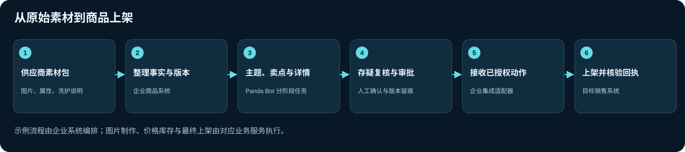
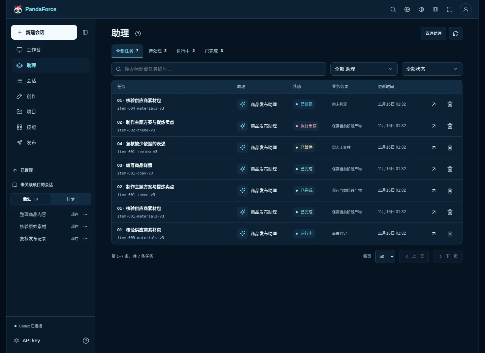

# PandaForce

可自行部署的 AI 工作台，集中管理会话、编程、文档、可复用技能、知识和发布。当前执行引擎为 Codex app-server。

基于 [lezi-fun](https://github.com/lezi-fun) 的 [Codex WebUI](https://github.com/lezi-fun/codex-webui) 开发，感谢上游作者及所有贡献者。

[English](./README.md) · **[完整功能清单](./panda-docs/i18n/zh-Hans/docusaurus-plugin-content-docs/current/features.md)** · [Feature catalog](./panda-docs/docs/features.md) · [安装指南](./panda-docs/docs/installation.md) · [CDN 配置](./panda-docs/i18n/zh-Hans/docusaurus-plugin-content-docs/current/cdn-build.md)

> 本 README 描述 **develop 分支源码**。`hiforceai/panda-force:0.0.21` 等已发布镜像不会自动包含 develop 的变更。体验下方界面及功能，请从此分支构建。

develop 源码还支持生成实际图片、可编辑 PPTX、HTML 网页与无声动态排版 MP4，并在项目文档中预览或下载原件。管理员可选配独立的 [S3 兼容原件存储](./panda-docs/docs/storage.md#s3-compatible-storage-for-saved-originals-develop-source)：经应用授权访问，回收站可恢复，彻底删除时清理自有 S3 版本。以上源码功能与当前已发布容器镜像分开记录。

## 可以做什么

- **AI 对话与编程：**流式接收回复、检查工具和文件变更、处理审批与问题、排队输入，并查看会话用量。
- **组织实际工作：**集中管理项目目录、会话、文档和产物；管理员可浏览允许的文件目录并使用集成终端。
- **撰写和完善文档：**使用文档树与富文本编辑、表格、图片和代码块，自动保存及恢复草稿，审阅后再应用 AI 建议。
- **复用技能和模板：**按分类浏览、检查版本及权限、安装兼容包，并组合当前可用技能与参数。
- **创作与发布：**保存个人作品、复制到项目、准备网站构建及受支持渠道版本，或直接导出内容与素材。
- **助理自动任务：**通过访问密钥接收外部任务，查看持久队列和判断依据，人工复核并重试失败回调。
- **搜索与知识：**检索项目内容，按需接入关键词或向量后端，执行基于来源依据的知识工作流。
- **本地账号管理：**配置 SMTP 后通过邮箱邀请成员，由成员自行设密，并使用六位邮件验证码找回密码。
- **桌面和手机：**响应式布局、可调导航、主题，以及英文、简体中文、香港繁体和台湾繁体界面。

[完整功能清单](./panda-docs/i18n/zh-Hans/docusaurus-plugin-content-docs/current/features.md) 覆盖 18 个功能领域、服务前提和当前限制。不同发布适配器的覆盖范围不同；企业成员沙箱、模型网关配额计费及通用 SSO 尚未交付。

## 使用案例：从供应商素材到商品发布上架

收到原始素材包后，企业商品系统先整理事实与版本，再提交 Bot 任务，完成**主题方案、商品卖点提炼和详情编写**。依据不足时进入**人工复核**；已审批动作连接企业已有的发布作业，最后单独**核验上架回执**。





**[查看完整案例：助理配置、受限访问密钥、API任务示例、复核、回调与上架回执 →](./panda-docs/i18n/zh-Hans/docusaurus-plugin-content-docs/current/bot-product-publishing.md)**

企业系统负责素材解包、主题图片制作、审批、商品落库和最终上架；Panda 串联其中的 AI 任务与已声明动作。截图使用虚构任务和模拟结果，没有执行生产上架，案例不出现具体商品品牌或销售渠道名称。

## 当前界面

以下为当前源码的真实界面渲染，使用虚构演示数据，不含生产账号、业务任务或凭据。

**工作台：直接进入项目与创作**


**项目文档：目录、富文本内容与编辑工具**


<details>
<summary>查看技能库和手机界面</summary>


</details>

## 从当前分支构建运行

需要 Git、Docker 和 Compose。文档镜像平台为 Linux amd64。构建和运行镜像已包含 Codex CLI，无需提前在宿主机安装 Codex，也无需挂载宿主机认证文件。

```bash
git clone --branch develop https://github.com/hiforce/panda-force-free.git
cd panda-force-free
docker compose -f docker-compose.yml -f docker-compose.build.yml up -d --build
docker compose logs panda-force
```

打开 **http://localhost:8899**，创建 PandaForce 管理员。初始化时邮箱可选，密码至少六位，包含大小写字母和数字。如果要求安装验证码，请在启动日志中查看。

模型账号需要单独登录：

```bash
docker compose exec -it panda-force codex login --device-auth
docker compose restart panda-force
```

按终端链接完成登录，刷新 PandaForce 后即可开始会话。API Key 和其他模型配置见[模型服务商指南](./panda-docs/i18n/zh-Hans/docusaurus-plugin-content-docs/current/model-providers.md)。PandaForce 账号与模型凭据相互独立，模型费用遵循服务商规则。

管理员先配置 SMTP，再绑定邮箱、邀请成员或使用邮件找回。成员自行设置密码。管理员可以访问共享宿主机工作区和引擎，普通成员使用其有权限的业务内容。共享引擎安装模式不提供不受信任用户的编程沙箱。

源码打包默认执行编译与打包检查。开发时独立运行 `bun run check` 和受影响行为检查，镜像构建完成不等于全产品回归通过。

## 使用已发布镜像

如需现有已发布版本，克隆默认分支后运行 `docker compose up -d`；其当前模板选择 **`hiforceai/panda-force:0.0.21`**。请按该版本文档使用，不要假定它与 develop 功能一致。

状态、模型认证、附件和工作文件通过 Docker 卷持久保存，重启容器不会丢失；`docker compose down` 保留这些卷。默认端口仅本机可访问。远程访问见[安装指南](./panda-docs/docs/installation.md)，挂载和备份见[存储指南](./panda-docs/docs/storage.md)。

## 可选服务与配置

| 需求                     | 入口                                                                                                                                                                                                                       |
| ------------------------ | -------------------------------------------------------------------------------------------------------------------------------------------------------------------------------------------------------------------------- |
| 使用宿主机已有的 Codex   | [共享模式安装](./panda-docs/docs/installation.md#use-codex-already-installed-on-the-host)；挂载服务 socket 与工作目录，仅挂载认证文件不能共享会话。                                                                        |
| 持久项目目录             | [存储指南](./panda-docs/docs/storage.md)；`PANDA_FORCE_PROJECTS_ROOT` 设置根目录，`PANDA_FORCE_ALLOW_EXTERNAL_DIRECTORIES=false` 把目录及会话浏览限制在该根目录。                                                          |
| 网站构建、文档预览或搜索 | 按需使用 `docker-compose.documents.yml`、`docker-compose.previews.yml`、`docker-compose.search.yml`，并配置对应服务。                                                                                                      |
| 使用自己的镜像仓库       | 可覆盖镜像和拉取策略；需要时通过 `docker-compose.documents.registry.yml` 接入独立管理的仓库凭据。                                                                                                                          |
| 使用自己的 S3 兼容 CDN   | [CDN 构建指南](./panda-docs/i18n/zh-Hans/docusaurus-plugin-content-docs/current/cdn-build.md)；使用自有 bucket、前缀、区域、可选 endpoint、访问 URL 和独立凭据文件。默认静态资源来自本站，启用 CDN 后 API 和认证仍在本站。 |
| Kubernetes 或多实例      | [Kubernetes 模板](./panda-docs/docs/kubernetes.md)与[集群配置](./panda-docs/docs/cluster.md)，普通安装不需要 Kubernetes。                                                                                                  |

## 支持开发

[](https://buymeacoffee.com/hiforce)

如果 PandaForce 对你有帮助，欢迎请 Rocky 喝杯咖啡。赞助完全自愿，不包含 SLA、优先支持或承诺的响应与修复期限。

## 许可证与致谢

采用 [MIT 许可证](./LICENSE)，个人及商业使用、修改和 fork 均免费。托管、模型、存储及外部平台可能单独收费。项目尽力维护。[第三方声明](./THIRD_PARTY_NOTICES.md)。

PandaForce Free 衍生自 MIT 许可的 [lezi-fun/codex-webui](https://github.com/lezi-fun/codex-webui)。感谢 lezi-fun 及所有上游贡献者。原始版权声明和 MIT 许可保留在 [LICENSE](./LICENSE) 与 [LICENSES/upstream-MIT.txt](./LICENSES/upstream-MIT.txt) 中。PandaForce 独立开发维护，上游署名不代表上游对本项目背书。
