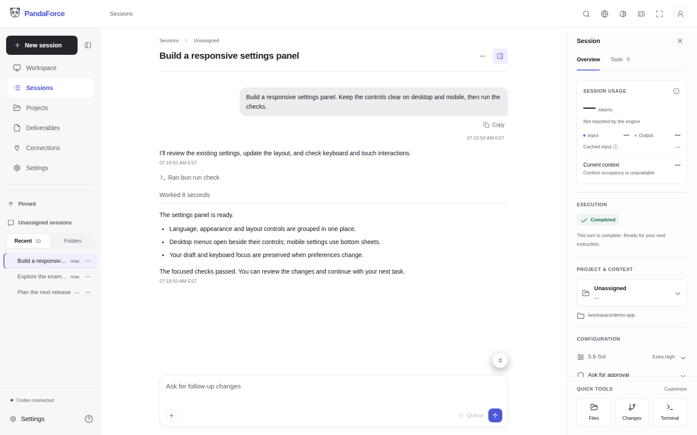

用自然语言开展工作的工作台。当前支持 Codex，其他 CLI 引擎尚未接入。

基于 [lezi-fun](https://github.com/lezi-fun) 的 [Codex WebUI](https://github.com/lezi-fun/codex-webui) 开发，感谢上游作者及所有贡献者。

- 用项目组织会话，上传文件与图片。
- 在顶部导航统一设置语言、外观和阅读宽度。
- 处理审批、回答问题、查看任务进度。
- 在响应式侧栏中集中查看会话用量、设置和工具。
- 浏览工作目录文件，使用集成终端。
- 界面支持英文和简体中文，未设置时跟随浏览器，英文兜底；原生 CLI 输出保留原文。

[English](./README.md) · [帮助文档](./panda-docs/docs/overview.md)



## 快速开始

需要 Linux amd64、Docker Compose 和 Git。镜像已包含 Codex CLI，无需在宿主机安装 Codex，也无需挂载宿主机认证文件。默认由 PandaForce 在容器内启动自己的 Codex 服务（**isolated 模式**）。

```bash
git clone https://github.com/hiforce/panda-force-free.git
cd panda-force-free
docker compose up -d
docker compose logs panda-force
```

打开 **http://localhost:8899**，创建 PandaForce 管理员。密码至少六位，包含大小写字母和数字。如需安装验证码，请在启动日志中查看。

模型账号需要单独登录：

```bash
docker compose exec -it panda-force codex login --device-auth
docker compose restart panda-force
```

按终端显示的链接完成登录，然后刷新 PandaForce，即可开始会话。PandaForce 管理员与模型账号相互独立；模型服务的权限和费用遵循服务商规则。

默认镜像为 **`hiforceai/panda-force:0.0.14`**。管理员、模型认证、附件及工作文件保存在 Docker 卷中，重启容器不会丢失。`docker compose down` 保留数据卷。默认端口仅本机可访问。

## 宿主机已有 Codex？

PandaForce 仍然运行在容器里，也可以把任务交给机器上已有的 Codex 服务执行（**shared 模式**），复用该服务的登录状态。这时不会在容器内另起 Codex 服务，也不用在容器内重新登录。需要挂载服务 socket 与工作目录；仅挂载认证文件无法共享会话。具体操作见 [Linux 宿主机接入指南](./panda-docs/docs/installation.md#use-codex-already-installed-on-the-host)。

远程访问和源码构建见 [安装指南](./panda-docs/docs/installation.md)，备份见 [存储指南](./panda-docs/docs/storage.md)。

K8s 部署可下载 [两种方式的 YAML 模板](./panda-docs/docs/kubernetes.md)，按指南填写自己的节点和目录配置。

## 支持开发

[](https://buymeacoffee.com/hiforce)

如果 PandaForce 对你有帮助，欢迎请 Rocky 喝杯咖啡。赞助完全自愿，不包含 SLA、优先支持或承诺的响应与修复期限。

## 许可证

采用 [MIT 许可证](./LICENSE)，个人及商业使用、修改和 fork 均免费。尽力维护，不承诺 SLA、响应时间或修复期限。[第三方声明](./THIRD_PARTY_NOTICES.md)。

## 上游与致谢

PandaForce Free 衍生自 MIT 许可的 [lezi-fun/codex-webui](https://github.com/lezi-fun/codex-webui)。感谢 lezi-fun 及上游贡献者提供的基础与开源贡献。

原始版权声明与 MIT 许可保留在 [LICENSE](./LICENSE) 和 [LICENSES/upstream-MIT.txt](./LICENSES/upstream-MIT.txt) 中；其他组件的出处见 [THIRD_PARTY_NOTICES.md](./THIRD_PARTY_NOTICES.md)。PandaForce 独立开发维护，上游署名不代表上游对本项目背书。
