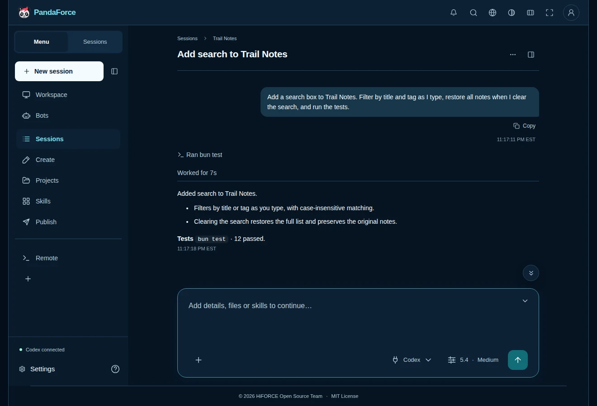
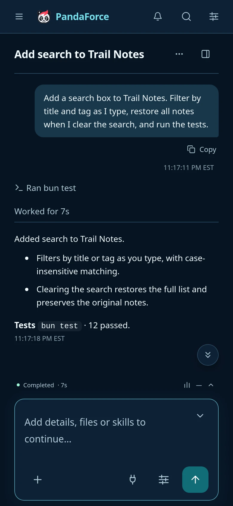
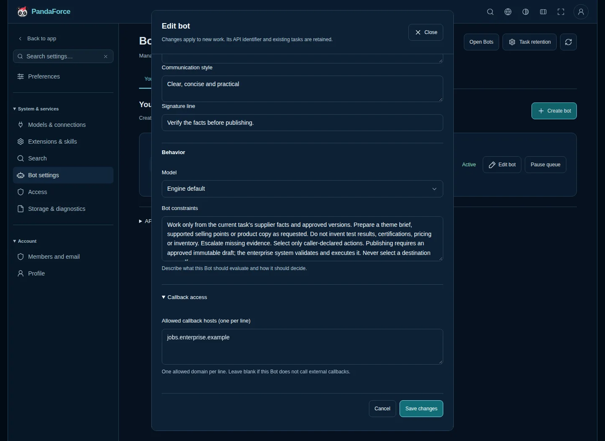

<p align="center">
  
</p>

<p align="center">
  <a href="https://github.com/hiforce/panda-force-free/tags"></a>
  <a href="./LICENSE"></a>
  <a href="./src"></a>
  <a href="https://hub.docker.com/r/hiforceai/panda-force/tags"></a>
  <a href="./panda-docs/docs/harness-runtimes.md"></a>
</p>

PandaForce is an open-source, self-hosted web workspace for **Codex**, **ZCode**, **Grok Build**, **[Google Antigravity CLI](./panda-docs/docs/harness-runtimes.md#antigravity-cli)**, and **[Claude Code](./panda-docs/docs/harness-runtimes.md#choose-host-or-container-mode)**. Open a project, choose a runtime and model, and work with your coding agent in the browser. Follow tool activity, review approvals, and resume earlier sessions. To enable Antigravity in Docker, follow the guide to build the optional image and sign in with Google. Claude Code uses an operator-installed CLI and ACP adapter.

**Works in desktop and mobile browsers.** Use HTTPS and sign in to your own instance to pick up your work wherever you have a connection.

[Install with Docker Compose](#install-0110) · [Set up Harness runtimes](./panda-docs/docs/harness-runtimes.md) · [Secure remote access](./panda-docs/docs/security.md) · [简体中文](./README-zh.md)



_Simulated conversation captured in the real interface. The project, messages, and test results are demo data._

<details>
<summary><strong>See the same conversation in a phone browser</strong></summary>



</details>

You can also [create illustrations, slides, web pages, and documents with skills](#create-something-fun) and [hand repeatable tasks off to Bots through the API](#meet-your-bot).

> **PandaForce 0.1.10** fixes Full access in new Claude Code conversations and restores model discovery and test messages for host runtimes. [Install the release →](#install-0110) · [Release notes →](./panda-docs/docs/releases.md#0110) · [Harness setup →](./panda-docs/docs/harness-runtimes.md)

## Create something fun

### “Introduce Greek history—as a comic.”

Choose **Knowledge Illustration Brief** (`science-illustration`) in **Create**, ask for an image, and give it a subject:

> Introduce Greek history as an eight-panel comic, with a date, heading and one-line explanation in each panel. Use English labels and dialogue.

<p align="center">
  <a href="./panda-docs/static/img/greek-history-comic-en.png"></a>
</p>

_An original AI-generated illustration created for this README. Click for the original PNG. Generated educational content should be reviewed before reuse._

Open the saved image to see the original, or keep refining the same creation:

> Make the dialogue more playful. Keep the timeline and use larger text.

The skill helps organize the story and visual brief. The configured model and rendering tools produce the image. Ask for the finished artifact: you should receive the actual image, rather than just a document describing what to draw.

You can use the same flow for “explain computer history as an illustrated timeline,” “turn these notes into slides,” or “make a landing page for this idea.” Follow-up edits stay connected through the creation identity, with the conversation and versions available together.

| What you want               | What you keep                                      |
| --------------------------- | -------------------------------------------------- |
| Illustration or infographic | An image preview and the original image file       |
| Presentation                | An editable PPTX and its available preview         |
| Web page                    | HTML source and an isolated web preview            |
| Motion graphic              | A silent MP4 made from supported visual scenes     |
| Writing or research         | An editable document and its sources when supplied |

Available output depends on configured model/tool capabilities. Video currently means **silent motion graphics**, not a general text-to-film service. Project documents can preview supported file types and offer original downloads for others.

<details>
<summary><strong>Explore the skills library, document editor and mobile view</strong></summary>

Screenshots below are freshly captured from the current source with fictional demo data. The skill library shows the current illustrated covers.

**A skill for your next creative move**


**A focused space for your words**


**Keep creating on your phone**


</details>

### Bring your own storage

Save originals locally, or configure **your own S3-compatible bucket** and select which content types use it—for example, generated images and videos. Thumbnails work without setting up image-processing rules in your bucket.

Private S3 originals use authenticated application authorization followed by **direct browser delivery through a temporary signed URL**. The file bytes travel from object storage to the browser. “Get image link” provides a reusable link with an expiry notice, valid for up to 24 hours; someone you share that link with can use it until expiry. Trash remains recoverable; permanent deletion cleans up the owned remote originals. [Storage guide →](./panda-docs/docs/storage.md#s3-compatible-storage-for-saved-originals)

## Meet your Bot

A Bot is your panda with a particular job and personality. Give it a name, avatar, role, voice and working rules. A careful product editor and a curious research assistant can use different instructions and models while keeping their task queues separate.

### Set one up

1. Go to **Settings → Bot settings**, create a Bot and choose its model, avatar and personality.
2. Set a stable code, such as `catalog-panda`, and the instructions it should follow.
3. Issue a **Bot access key**, scoped to that Bot, with an expiry date. Store the one-time secret in your integration's secret manager.
4. Submit work from your application. Inspect the queue, evidence and results in **Bots**; uncertain tasks can ask for human review.



### Submit, query, cancel

Set `PANDA_URL`, `BOT_CODE` and `BOT_KEY` to your installation and scoped key. Run these commands from the repository root with `curl` and `jq` installed:

```bash
export PANDA_URL="http://localhost:8899"
export BOT_CODE="catalog-panda"
# Set BOT_KEY from your secret manager. Do not commit it.

TASK_ID=$(curl --fail-with-body --silent --show-error \
  "$PANDA_URL/api/v1/bots/$BOT_CODE/tasks" \
  -H "Authorization: Bearer $BOT_KEY" \
  -H "Idempotency-Key: ITEM-001-v1" \
  -H "Content-Type: application/json" \
  --data-binary @examples/bots/quickstart/task.json | jq -er '.task.id')

curl --fail-with-body --silent --show-error \
  "$PANDA_URL/api/v1/bots/$BOT_CODE/tasks/$TASK_ID" \
  -H "Authorization: Bearer $BOT_KEY"

# Cancel queued/running work when it is no longer needed.
curl --fail-with-body --silent --show-error \
  "$PANDA_URL/api/v1/bots/$BOT_CODE/tasks/$TASK_ID/cancel" \
  -H "Authorization: Bearer $BOT_KEY" \
  -H "Content-Type: application/json" --data '{}'
```

New submissions return `202`; the same idempotency key and payload return the existing task. Save `task.id` and poll the query endpoint. Cancellation is idempotent for a canceled task; finished tasks and callbacks with uncertain/in-flight external effects return `409`. Canceling a task cannot undo an external action that already happened.

| API                                                     | Authentication                         |
| ------------------------------------------------------- | -------------------------------------- |
| `GET /api/bots` — list Bots, tasks and key metadata     | Signed-in application session          |
| `GET /api/bots/navigation` — Bot IDs, names and avatars | Signed-in application session          |
| `POST /api/bots` — create a Bot                         | Signed-in application session + Origin |
| `PATCH /api/bots/:id` — configure it                    | Signed-in application session + Origin |
| `POST /api/bots/keys` — issue a scoped key              | Signed-in application session + Origin |
| `POST /api/v1/bots/:code/tasks` — submit                | Bot key + `Idempotency-Key`            |
| `GET /api/v1/bots/:code/tasks/:id` — query              | Bot key                                |
| `POST /api/v1/bots/:code/tasks/:id/cancel` — cancel     | Bot key, empty JSON object             |

**[Management API bootstrap, runnable payloads, states and integration details →](./panda-docs/docs/bot-api-quickstart.md)**

### A practical scenario: product content review

Your product system sends verified facts for `ITEM-001`. Catalog Panda drafts a description and selects `draft_ready`, or requests review when evidence is missing. Your application reads the result, presents it for approval, and saves or publishes through its own workflow. If the source item is withdrawn while the Bot is working, it cancels the task using the endpoint above.

For a larger workflow—supplier assets, a theme brief, product details, human review and publication receipts—see the **[complete integration walkthrough](./panda-docs/docs/bot-product-publishing.md)**. Callbacks execute only actions declared by your application, with allowed destination hosts. A model decision alone is not proof of publication.

**Assistant is your Bot hub.** Manage Bots in a compact list, then choose a sidebar avatar to open that Bot’s ongoing conversation. Human chat and background tasks use separate context. Add RSS/Atom research or Gmail draft workflows, keep results in a private channel (30 days by default), and optionally deliver through a verified Slack connection. Automatic email replies require an explicit sender policy and limit. [Conversations, schedules, connections and recovery →](./panda-docs/docs/bot-workspace.md)

## Teach your panda new moves

- **Skills** package a repeatable method: instructions, resources and parameters for writing, research or visual creation. Browse, install and combine compatible skills instead of starting from an empty prompt each time.
- **Plugins and tools** add capabilities through supported extension contracts, with versioning and explicit access. A skill describes how to work; a configured tool performs the action.
- **Bots** put a chosen personality and working rules behind an integration API, with durable tasks, human review and recovery.
- **Projects and knowledge** keep source material, conversations, documents and saved artifacts connected so you can keep refining the work.

“Learning kung fu” means adding and improving these reusable capabilities—not silently retraining a model. Bring your own model credentials and enable the tools your workflow needs. [Skills](./panda-docs/docs/features.md#skills-and-skill-packages) · [Plugins](./panda-docs/docs/features.md#templates-themes-and-extensions) · [Model configuration](./panda-docs/docs/model-providers.md)

PandaForce also includes streaming AI conversations and coding, a terminal for administrators, rich-text documents, publishing adapters, source-based knowledge workflows and search. Desktop and mobile layouts support English, Simplified Chinese, Hong Kong Traditional Chinese and Taiwan Traditional Chinese. **[Explore all features and prerequisites →](./panda-docs/docs/features.md)**

## Multiple Harness Runtimes

The 0.1.10 image contains **Codex CLI 0.171.0**, **Grok Build 1.0.89**, and **ZCode CLI 0.17.1**. In conversations, assistants/Bots and supported creation settings, choose **Harness Runtime → model → reasoning level**. Finish the current turn before switching a conversation; selected context is handed over and files remain in the workspace. See the [multi-runtime guide](./panda-docs/docs/harness-runtimes.md#use-several-named-runtimes) for account isolation and the optional Antigravity setup.

Codex starts through the application's app-server connection. Grok uses on-demand ACP processes; its optional account service handles native credential renewal. No host Grok/tmux session is required. Provider logins remain separate from the PandaForce administrator. [Container roles, login, persistence and recovery →](./panda-docs/docs/harness-runtimes.md)

## Install 0.1.10

Clone the **`main` branch** for the installation configuration and run **`hiforceai/panda-force:0.1.10`** for **Linux amd64**. The image uses **Rocky Linux 9** and includes all three Harness CLIs, Bun, Node.js, Python, Office, PDF/OCR, fonts, image/research/writing libraries, Chromium and FFmpeg. The host needs Git and Docker with Compose. [Base image contents and purpose →](./panda-docs/docs/base-images.md)

```bash
git clone --branch main --depth 1 https://github.com/hiforce/panda-force-free.git
cd panda-force-free
docker compose pull panda-force
docker compose up -d --no-build
docker compose logs panda-force
```

Open **http://localhost:8899** and create the administrator. The password requires at least six characters including uppercase, lowercase and a number. If requested, read the installation code from the container startup logs. Choose **SQLite** or **Configure MySQL** after bootstrap. [Installation and database selection →](./panda-docs/docs/installation.md)

**Codex account:**

```bash
docker compose exec -it panda-force codex login --device-auth
docker compose restart panda-force
```

**Grok Build account and automatic native renewal:** add the version-matched account-service overlay, then complete device login:

```bash
docker compose -f docker-compose.yml -f deploy/harness/docker-compose.grok.yml pull
docker compose -f docker-compose.yml -f deploy/harness/docker-compose.grok.yml up -d
docker compose -f docker-compose.yml -f deploy/harness/docker-compose.grok.yml \
  run --rm grok-auth grok --no-auto-update login --device-auth
```

Open **Settings → Harness Runtimes**, check Grok Build, and select its model/effort. The explicit **hi** test sends a real small request using your model account. The application and Grok helper services use the same 0.1.10 image by default. [Detailed setup and account volumes →](./panda-docs/docs/harness-runtimes.md)

**ZCode conversation runtime (experimental)**

The image already includes the ZCode CLI. Use the optional Compose configuration to mount your provider JSON, then add a runtime in **Settings → Harness Runtimes**. Default installations can skip this setup. [Configuration steps →](./panda-docs/docs/harness-runtimes.md#zcode)

State, Codex login, Grok account and workspace files persist in separate Docker volumes. Keep the same Compose project/volume names when upgrading and check `.env` for an old `PANDA_FORCE_IMAGE` override. `docker compose down` preserves named volumes. The default port binds to localhost; configure your own HTTPS entry for remote access. [Storage and backups →](./panda-docs/docs/storage.md)

## Developer documentation

For source contributions and custom images, use the [development guide](./panda-docs/docs/building.md). The [base image guide](./panda-docs/docs/base-images.md) covers tool contents, dependency maintenance and custom registries.

## Optional services and configuration

| Need                                        | Where to start                                                                                                                                                                                                                                     |
| ------------------------------------------- | -------------------------------------------------------------------------------------------------------------------------------------------------------------------------------------------------------------------------------------------------- |
| Existing Codex on the host                  | [Shared-mode installation](./panda-docs/docs/installation.md#use-codex-already-installed-on-the-host); mount the service socket and workspace, not just authentication files.                                                                      |
| Persistent project folders                  | [Storage](./panda-docs/docs/storage.md); `PANDA_FORCE_PROJECTS_ROOT` sets the root, and `PANDA_FORCE_ALLOW_EXTERNAL_DIRECTORIES=false` limits directory/session browsing to it.                                                                    |
| Website builds, document previews or search | Use the relevant `docker-compose.documents.yml`, `docker-compose.previews.yml` and `docker-compose.search.yml` overlays and configure the corresponding services.                                                                                  |
| Your own registry                           | Override images/pull policies; supply separately managed credentials with `docker-compose.documents.registry.yml` when required.                                                                                                                   |
| Your own S3-compatible CDN                  | [CDN build guide](./panda-docs/docs/cdn-build.md); preserve your bucket, prefix, region, optional endpoint, viewer URL and separate credential file. Static assets default to this application; APIs/authentication stay here when CDN is enabled. |
| Kubernetes or multiple instances            | [Kubernetes templates](./panda-docs/docs/kubernetes.md) and [cluster configuration](./panda-docs/docs/cluster.md). Kubernetes is optional.                                                                                                         |

## Support

[](https://buymeacoffee.com/hiforce)

If PandaForce helps you, consider supporting Rocky's work. Contributions are voluntary and do not include an SLA, priority support, or a guaranteed response or fix deadline.

## License and acknowledgements

[MIT](./LICENSE), free for personal and commercial use, modifications and forks. Hosting, models, storage and external platforms may charge separately. Maintenance is best effort. [Third-party notices](./THIRD_PARTY_NOTICES.md).

PandaForce Free is derived from the MIT-licensed [lezi-fun/codex-webui](https://github.com/lezi-fun/codex-webui). Thank you to lezi-fun and all upstream contributors. The original copyright and MIT license are preserved in [LICENSE](./LICENSE) and [LICENSES/upstream-MIT.txt](./LICENSES/upstream-MIT.txt). PandaForce is developed independently; upstream attribution does not imply endorsement.
