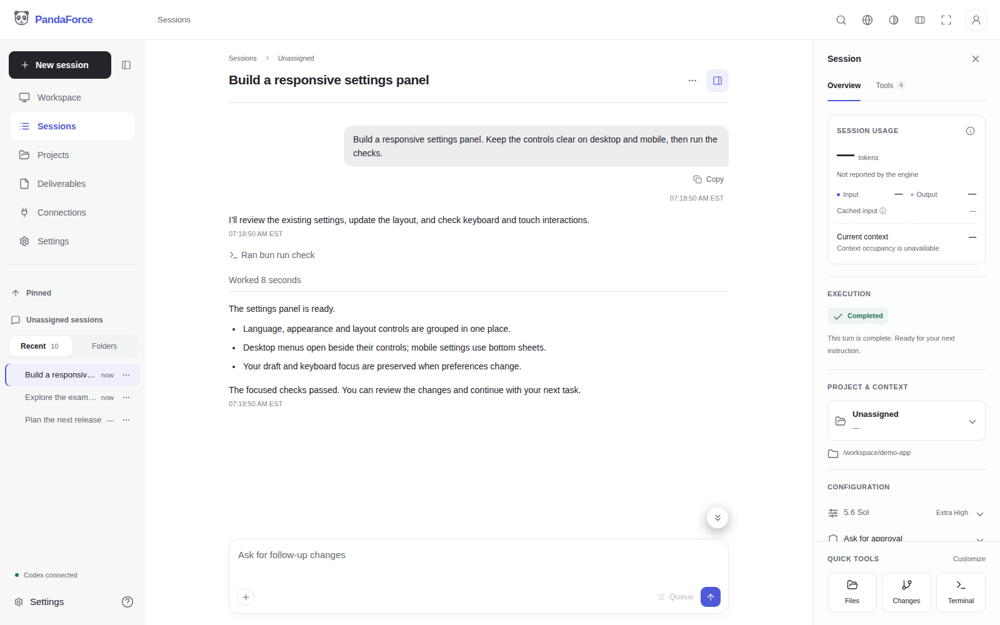

A workspace for natural-language work, powered by Codex today, with other CLI engines planned.

Built on [Codex WebUI](https://github.com/lezi-fun/codex-webui) by [lezi-fun](https://github.com/lezi-fun). Thank you to the upstream author and contributors.

- Organize conversations into projects and attach files or images.
- Review approvals, answer questions and follow task progress.
- Keep session usage, settings and tools together in a responsive side panel.
- Customize language, appearance and reading width from the top navigation.
- Browse workspace files and use the integrated terminal.
- Use English or Simplified Chinese, follow your browser language, and keep native CLI output in its original language.

[简体中文](./README-zh.md) · [Help](./panda-docs/docs/overview.md)



## Quick start

Requires Docker with Compose and Git on Linux amd64. The published image includes Codex CLI; no host Codex installation or host authentication files are required. By default, PandaForce starts its own Codex service inside the container (**isolated mode**).

```bash
git clone https://github.com/hiforce/panda-force-free.git
cd panda-force-free
docker compose up -d
docker compose logs panda-force
```

Open **http://localhost:8899** and create your PandaForce administrator. Choose a password with at least six characters, including uppercase and lowercase letters and a number. If asked for an installation code, find it in the startup logs.

Sign in to your model account separately:

```bash
docker compose exec -it panda-force codex login --device-auth
docker compose restart panda-force
```

Follow the sign-in link shown in the terminal, then refresh PandaForce and start a conversation. Your PandaForce administrator is separate from your model account; provider access and charges follow your provider's terms.

The default image is **`hiforceai/panda-force:0.0.10`**. State, model credentials, attachments and workspace files persist in Docker volumes across container restarts. `docker compose down` keeps these volumes. The default port is accessible only from the local machine.

## Already use Codex on the host?

PandaForce can stay in its container and send tasks to Codex already running on your machine (**shared mode**), reusing that service's login. PandaForce does not start a separate Codex service in the container in this mode. Mount the service socket and workspace; mounting authentication files alone does not share sessions. Follow the [Linux host setup](./panda-docs/docs/installation.md#use-codex-already-installed-on-the-host).

See the [installation guide](./panda-docs/docs/installation.md) for remote access and source builds, and [storage guide](./panda-docs/docs/storage.md) for backups.

Download [Kubernetes deployment templates](./panda-docs/docs/kubernetes.md) for either arrangement.

## Support

[](https://buymeacoffee.com/hiforce)

If PandaForce helps you, consider supporting Rocky's work. Contributions are voluntary and do not include an SLA, priority support, or a guaranteed response or fix deadline.

## License

[MIT](./LICENSE), free for personal and commercial use, modifications and forks. Maintenance is best effort, with no SLA or guaranteed response/fix deadline. [Third-party notices](./THIRD_PARTY_NOTICES.md).

## Acknowledgements

PandaForce Free is derived from [lezi-fun/codex-webui](https://github.com/lezi-fun/codex-webui), originally released under the MIT license. We thank lezi-fun and all upstream contributors for the foundation their work provides.

The original copyright notice and MIT license are preserved in [LICENSE](./LICENSE) and [LICENSES/upstream-MIT.txt](./LICENSES/upstream-MIT.txt). Additional component attribution is recorded in [THIRD_PARTY_NOTICES.md](./THIRD_PARTY_NOTICES.md). PandaForce is developed independently; upstream attribution does not imply endorsement.
