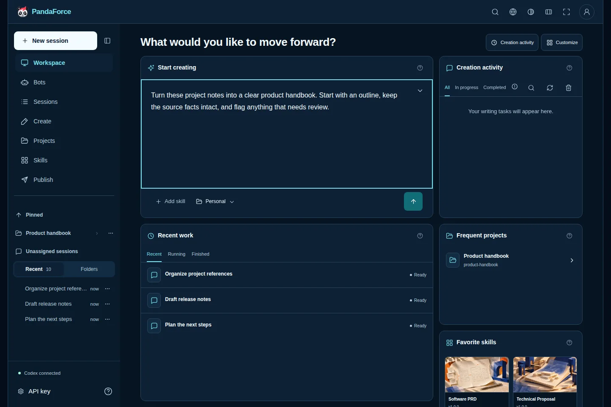
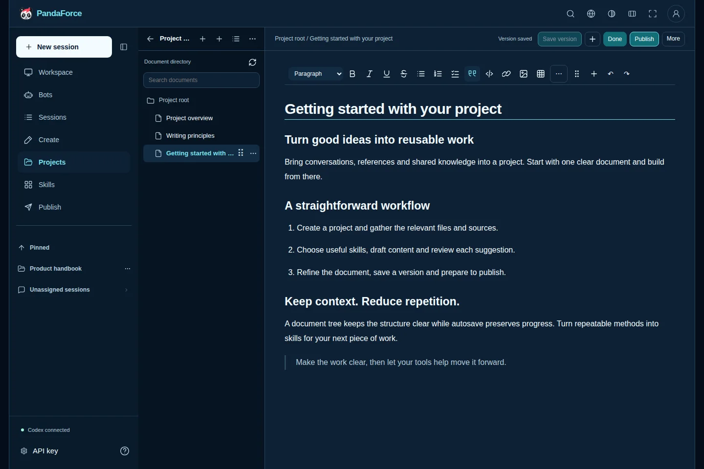
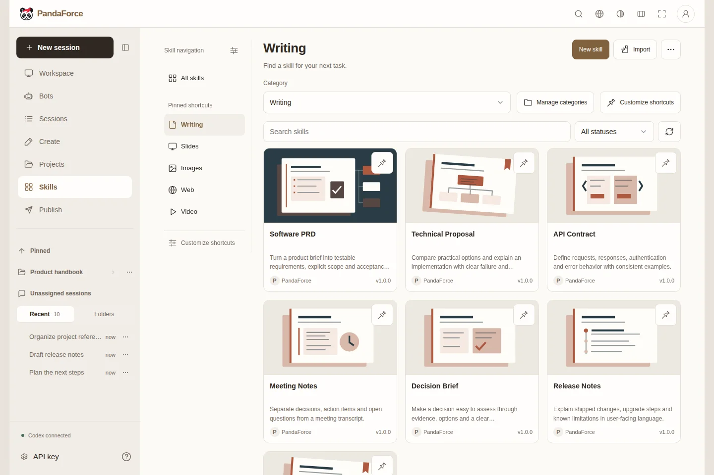
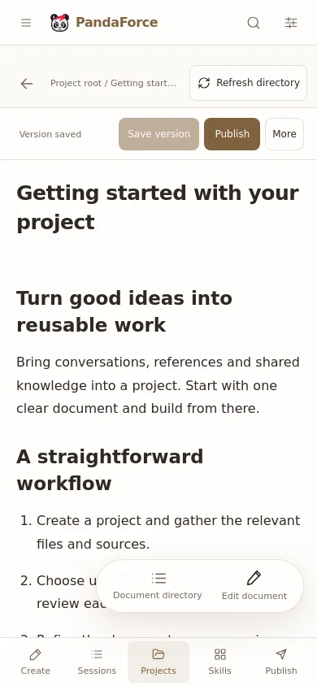

# PandaForce

A self-hosted AI workspace for conversations, coding, documents, reusable skills, knowledge and publishing. Powered by Codex app-server today.

Built on [Codex WebUI](https://github.com/lezi-fun/codex-webui) by [lezi-fun](https://github.com/lezi-fun). Thank you to the upstream author and contributors.

[简体中文](./README-zh.md) · **[Complete feature catalog](./panda-docs/docs/features.md)** · [功能清单（中文）](./panda-docs/i18n/zh-Hans/docusaurus-plugin-content-docs/current/features.md) · [Installation](./panda-docs/docs/installation.md) · [CDN configuration](./panda-docs/docs/cdn-build.md)

> This README describes the **develop source**. Published images such as `hiforceai/panda-force:0.0.21` do not automatically contain develop changes. Build from this branch to try the interface and functions shown below.

## What you can do

- **Talk and code with AI:** stream replies, inspect tools and file changes, handle approvals and questions, queue messages and follow session usage.
- **Organize real work:** keep project folders, conversations, documents and generated assets together; browse permitted files and use the integrated terminal as an administrator.
- **Write and refine documents:** use a document tree, rich-text editing, tables, images and code blocks; autosave, recover drafts and review AI suggestions before applying them.
- **Reuse skills and templates:** browse by category, inspect versions and permissions, install compatible packages and combine currently usable skills with parameters.
- **Create and publish:** keep personal works, copy them into projects, prepare website builds and supported channel variants, or export content and assets.
- **Automate with Bots:** accept external tasks with access keys, inspect the durable queue and decision evidence, review results and retry failed callbacks.
- **Search and build knowledge:** search project content, optionally add keyword/vector backends and run source-backed knowledge workflows.
- **Manage local accounts:** invite members by email, let them set their own passwords, and recover passwords using six-digit email codes after SMTP is configured.
- **Work on desktop or mobile:** responsive layouts, adjustable navigation, themes and English, Simplified Chinese, Hong Kong Traditional Chinese and Taiwan Traditional Chinese.

See the [complete feature catalog](./panda-docs/docs/features.md) for all 18 areas, service prerequisites and current limits. Optional publishing adapters have different coverage; enterprise member sandboxes, model-gateway quotas/billing and generic SSO are not shipped features.

## Current interface

The current source rendered with fictional demonstration data; no production accounts, tasks or credentials are shown.

**Workspace — a direct starting point for projects and creation**



**Project documents — outline, rich-text content and editing tools**



<details>
<summary>Skills and the mobile interface</summary>





</details>

## Run this branch from source

Requires Git and Docker with Compose. The documented image platform is Linux amd64. Codex CLI is included in the build/runtime images; no host Codex installation or host authentication-file mount is required.

```bash
git clone --branch develop https://github.com/hiforce/panda-force-free.git
cd panda-force-free
docker compose -f docker-compose.yml -f docker-compose.build.yml up -d --build
docker compose logs panda-force
```

Open **http://localhost:8899** and create your PandaForce administrator. Email is optional at initialization. Choose a password with at least six characters, including uppercase and lowercase letters and a number. If an installation code is requested, find it in the startup logs.

Sign in to the model account separately:

```bash
docker compose exec -it panda-force codex login --device-auth
docker compose restart panda-force
```

Follow the terminal link, refresh PandaForce and start a conversation. API-key and other model-provider configuration is described in the [model-provider guide](./panda-docs/docs/model-providers.md). PandaForce accounts and provider credentials are separate; provider charges follow the provider's terms.

Configure SMTP in administration before binding an email, inviting members or using email recovery. Members set their own passwords. Administrators retain access to the shared host workspace and engine; ordinary members use their authorized business content. This shared-engine installation is not an untrusted multi-user coding sandbox.

Source packaging defaults to compilation and packaging checks. Run `bun run check` and the affected behavior checks independently during development; a completed image build is not a full product regression result.

## Use a published image

For the existing published release, clone the default branch and run `docker compose up -d`; its current template selects **`hiforceai/panda-force:0.0.21`**. Consult that release's documentation rather than assuming feature parity with develop.

State, model credentials, attachments and workspace files persist in Docker volumes across container restarts. `docker compose down` keeps those volumes. The default port is accessible only from the local machine. See [installation](./panda-docs/docs/installation.md) for remote access and [storage](./panda-docs/docs/storage.md) for mounts and backups.

## Optional services and configuration

| Need                                        | Where to start                                                                                                                                                                                                                                     |
| ------------------------------------------- | -------------------------------------------------------------------------------------------------------------------------------------------------------------------------------------------------------------------------------------------------- |
| Existing Codex on the host                  | [Shared-mode installation](./panda-docs/docs/installation.md#use-codex-already-installed-on-the-host); mount the service socket and workspace, not just authentication files.                                                                      |
| Persistent project folders                  | [Storage](./panda-docs/docs/storage.md); `PANDA_FORCE_PROJECTS_ROOT` sets the root, and `PANDA_FORCE_ALLOW_EXTERNAL_DIRECTORIES=false` limits directory/session browsing to it.                                                                    |
| Website builds, document previews or search | Use the relevant `docker-compose.documents.yml`, `docker-compose.previews.yml` and `docker-compose.search.yml` overlays and configure the corresponding services.                                                                                  |
| Your own registry                           | Override images/pull policies; supply separately managed credentials with `docker-compose.documents.registry.yml` when required.                                                                                                                   |
| Your own S3-compatible CDN                  | [CDN build guide](./panda-docs/docs/cdn-build.md); preserve your bucket, prefix, region, optional endpoint, viewer URL and separate credential file. Static assets default to this application; APIs/authentication stay here when CDN is enabled. |
| Kubernetes or multiple instances            | [Kubernetes templates](./panda-docs/docs/kubernetes.md) and [cluster configuration](./panda-docs/docs/cluster.md). Kubernetes is optional.                                                                                                         |

## Support

[](https://buymeacoffee.com/hiforce)

If PandaForce helps you, consider supporting Rocky's work. Contributions are voluntary and do not include an SLA, priority support, or a guaranteed response or fix deadline.

## License and acknowledgements

[MIT](./LICENSE), free for personal and commercial use, modifications and forks. Hosting, models, storage and external platforms may charge separately. Maintenance is best effort. [Third-party notices](./THIRD_PARTY_NOTICES.md).

PandaForce Free is derived from the MIT-licensed [lezi-fun/codex-webui](https://github.com/lezi-fun/codex-webui). Thank you to lezi-fun and all upstream contributors. The original copyright and MIT license are preserved in [LICENSE](./LICENSE) and [LICENSES/upstream-MIT.txt](./LICENSES/upstream-MIT.txt). PandaForce is developed independently; upstream attribution does not imply endorsement.
