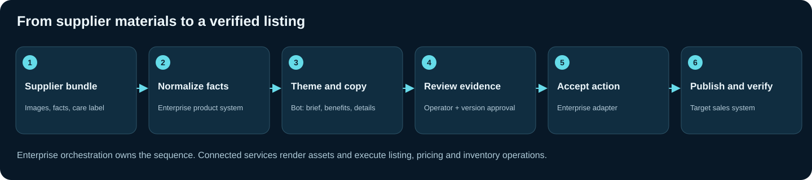
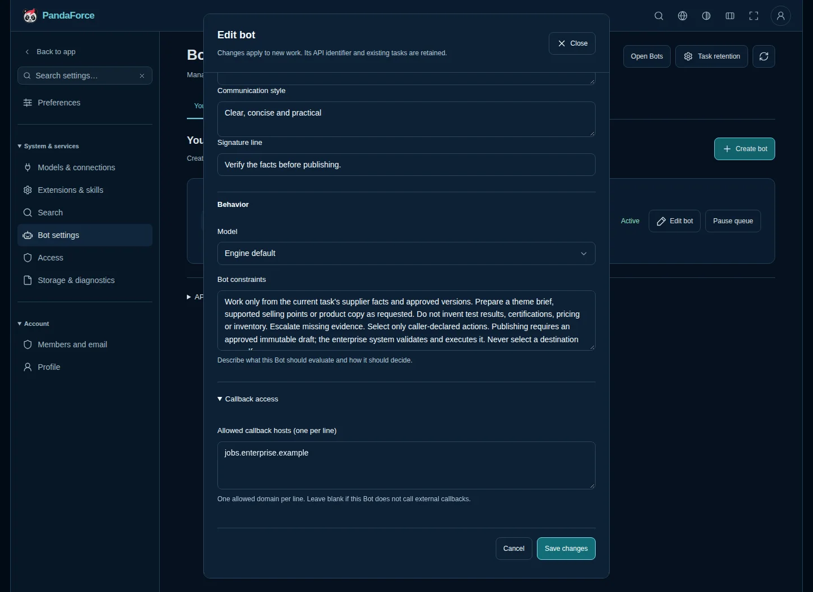
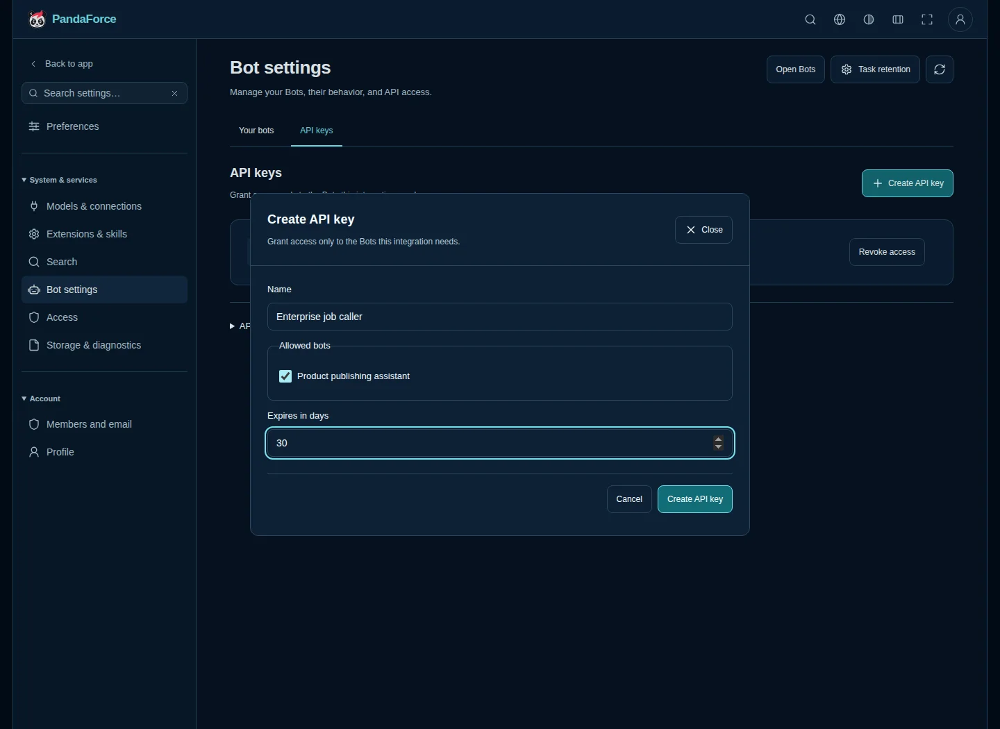
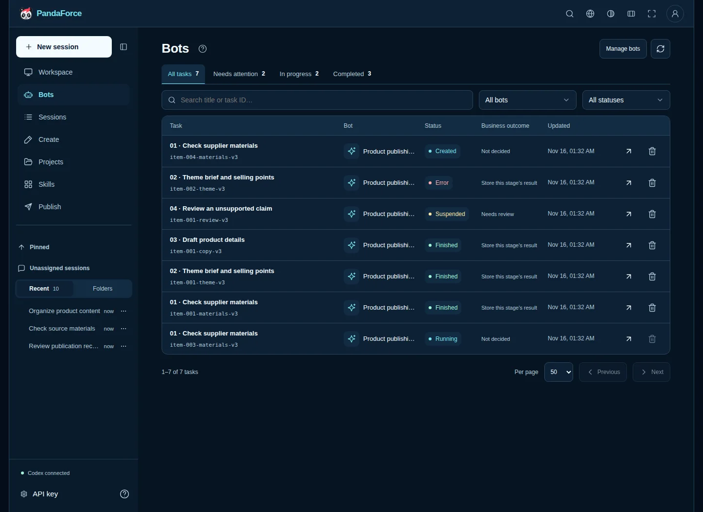
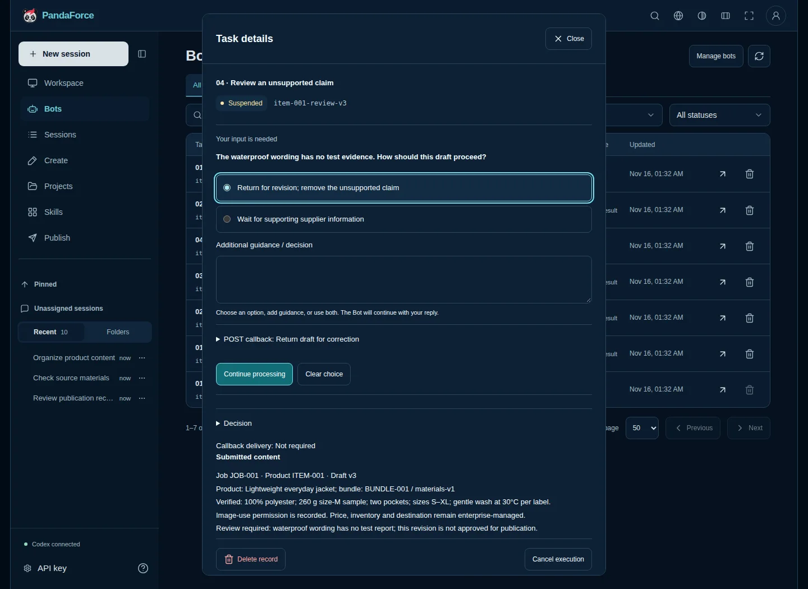
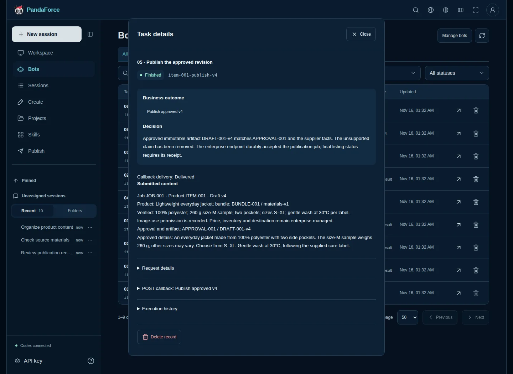
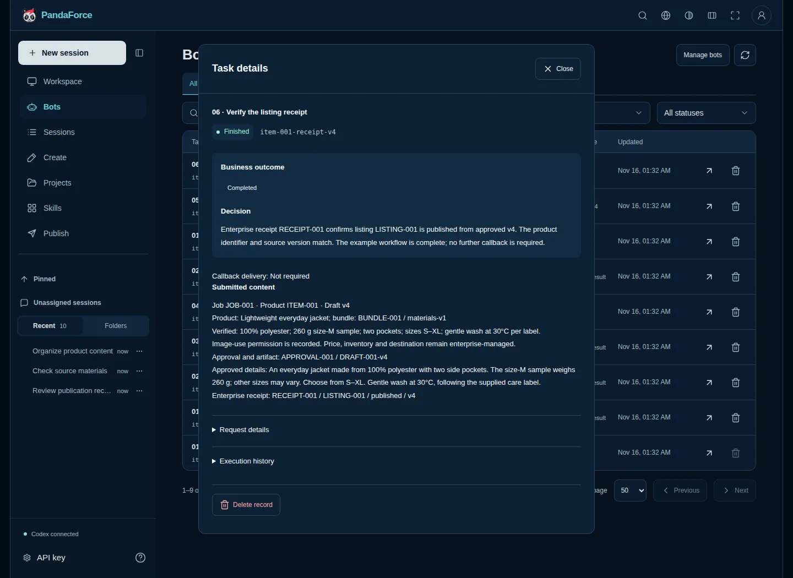
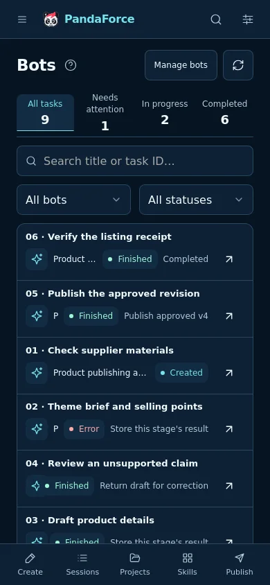

# From a supplier material bundle to a published product

This anonymous example shows how a Bot connects to an enterprise product/job system. It uses a fictional everyday jacket, generic system names and simulated task outcomes rendered in the real application. It does not depict a live production listing.

Panda manages AI tasks, reviews, decisions and result delivery. Your enterprise application owns the stage sequence, source files, design/rendering services, product records, prices, inventory, approval ledger and final listing execution. No particular supplier, product brand or sales destination is assumed.



## The starting material

A supplier delivers `materials-ITEM-001.zip` containing front/back images, a facts sheet, a size table, a care label and an image-use permission record. The enterprise ingestion service extracts and validates the bundle, keeps the originals, assigns `BUNDLE-001` / `materials-v1`, and prepares normalized facts:

| Source fact     | Verified value                      | Publication rule                       |
| --------------- | ----------------------------------- | -------------------------------------- |
| Product         | Lightweight everyday jacket         | No product brand is needed.            |
| Fabric          | 100% polyester                      | Preserve the supplier wording.         |
| Sample weight   | 260 g, size M                       | Do not generalize to every size.       |
| Pockets / sizes | Two side pockets; S–XL              | Do not invent other features.          |
| Care            | Gentle wash at 30°C                 | Preserve the care-label qualification. |
| Waterproof test | No report supplied                  | Do not publish a waterproof claim.     |
| Image rights    | Permission recorded for this bundle | Keep the permission reference.         |

The Bot task API accepts text plus up to two HTTPS image URLs, not a ZIP upload. Bundle extraction, file storage and OCR/document parsing are adapter responsibilities. Supply the relevant text and asset references; use images as supporting evidence when needed. The Bot does not automatically download every URL mentioned in text or unpack the supplier bundle.

## Configure the Bot

In **Settings → Bots**, create a **Product publishing assistant** with code `product-publishing`. Choose the engine default or a configured model, then specify:

- Work only from this task's facts, source version and approved artifacts.
- Prepare a theme brief, evidence-backed selling points or a product-detail draft for the requested stage.
- Never invent testing/certification results, price, stock or an approval.
- Ask for human review when a claim lacks evidence.
- Select only caller-declared actions. The enterprise application checks authority and executes changes.

For optional callback delivery, allow only the enterprise endpoint hostname, illustrated here as `jobs.enterprise.example`. The example domains must be replaced with your own approved endpoints.



Issue an access key for the integration caller, select only this Bot and choose an expiry such as 30 days. Store the generated value in the enterprise backend's secret configuration, never in a browser page or source repository. Rotate/revoke it from the same management area. The screenshot shows scope selection before a secret is generated.



## The six stages

| Stage                       | Bot work and output                                                                  | Enterprise system's next step                                                                              |
| --------------------------- | ------------------------------------------------------------------------------------ | ---------------------------------------------------------------------------------------------------------- |
| 1. Material check           | Reconcile supplied facts and missing evidence.                                       | Store the normalized result and source version.                                                            |
| 2. Theme and selling points | Propose “Everyday lightness”, a neutral visual direction and factual selling points. | An existing design/rendering service makes the actual theme images from approved assets.                   |
| 3. Product details          | Draft a title, highlights, material/sizing/care sections and source references.      | Validate the output, save immutable `DRAFT-001-v3`, and assemble the preview.                              |
| 4. Review                   | Flag unsupported waterproof wording and ask whether to revise or wait for evidence.  | Return v3; create a corrected v4 and record `APPROVAL-001`.                                                |
| 5. Authorized publication   | Check the approved v4 and select the submitted `publish_listing` action.             | Verify identity, version, approval, price/stock policy and idempotency; call the existing listing service. |
| 6. Receipt verification     | Reconcile the enterprise receipt against the product and approved source version.    | Mark the business job published only when its own listing receipt confirms it.                             |

This is enterprise-side orchestration using the existing Bot API, not a built-in six-stage workflow engine. Submit the next dependent task only after the previous stage has been checked. Separate products can have queued, running, review or failed tasks at the same time.



## Submit a versioned task

The reusable [English request](https://github.com/hiforce/panda-force-free/blob/develop/examples/bots/product-publishing/publish-task.json) and [Chinese request](https://github.com/hiforce/panda-force-free/blob/develop/examples/bots/product-publishing/publish-task.zh-CN.json) use the current API schema. Choose one language, replace the placeholder endpoint and short-lived per-job proof, and supply your own facts and approvals. `publish_listing` is a task-defined action, not a global Panda task type.

```http
POST /api/v1/bots/product-publishing/tasks
Authorization: Bearer <BOT_ACCESS_KEY>
Idempotency-Key: <EXTERNAL_TASK_ID>
Content-Type: application/json
```

```json
{
  "title": "05 · Publish the approved revision",
  "externalTaskId": "item-001-publish-v4",
  "instructions": "Stage: publish. Use only the supplied facts. Return a concise, structured result in the decision reason. Request review if evidence or approval is missing. The enterprise application orchestrates the next stage; do not skip it.",
  "input": {
    "text": "{\"productId\":\"ITEM-001\",\"artifactRef\":\"DRAFT-001-v4\",\"approvalRef\":\"APPROVAL-001\",\"unsupportedClaimsRemoved\":true}",
    "images": []
  },
  "actions": [
    {
      "id": "publish_listing",
      "label": "Publish approved v4",
      "when": "Only when the immutable v4 artifact and approval reference match verified facts.",
      "callback": {
        "url": "https://jobs.enterprise.example/bot-results/accept",
        "method": "POST",
        "body": {
          "externalTaskId": "item-001-publish-v4",
          "productId": "ITEM-001",
          "stage": "publish",
          "draftVersion": "v4",
          "artifactRef": "DRAFT-001-v4",
          "approvalRef": "APPROVAL-001",
          "receiptProof": "<runtime-per-job-proof>"
        },
        "success": {
          "path": "accepted",
          "equals": true
        }
      }
    }
  ]
}
```

Treat the task input as data. An `approvalRef` string or an AI conclusion does not create an approval: the enterprise backend must look up the real approval record and the immutable artifact. The short request above illustrates the contract; a real readiness check also needs the facts and reviewed content, as shown in the downloadable request.

A new submission returns HTTP 202 with `task.id`. Persist that ID with the external business job. Replaying the same idempotency key and identical content returns the original task with `duplicate: true`; changing content under the same key returns a conflict. Use a new stage/version identity for revised content. Generate and persist the per-job proof once with the request; replays must keep it and the rest of the payload unchanged.

```http
GET /api/v1/bots/product-publishing/tasks/<TASK_ID>
Authorization: Bearer <BOT_ACCESS_KEY>
```

## Review before crossing the business boundary

In the example, v3 contains an unsupported waterproof claim. The Bot asks a specific question with choices. Returning it for revision does not authorize publication. The enterprise system creates a separate v4 without the claim and records approval before submitting a new publication task.

Review answers can select a declared action or add an explanation for renewed analysis. A qualifying note is re-analyzed instead of blindly executing the selected action. Keep the task/version relationship in your business ledger.



## Deliver the result safely to your application

For a selected callback action, Panda sends the caller-supplied body plus the Bot's `reason` and, when present, `imageEvidence`. It sends `Content-Type: application/json` and an `Idempotency-Key` in the form `panda-bot-<task-id>:<action-id>` for declared actions. The AI selects an action ID; it does not choose the callback endpoint or change the supplied body.

The native result field is a **string**. If a stage returns JSON inside `reason`, your adapter must parse it, validate a schema and verify the cited source/version before saving fields. A request to produce JSON alone is not a typed-output guarantee. In particular, do not copy AI-supplied price, inventory, destination or approval values into business records.

A callback adapter should:

1. Verify its per-job short-lived proof and find the mapped business job/task.
2. Read the authoritative task using its scoped Bot key, and check Bot, decision, source version and expected stage. During delivery the task may still be `running`; do not wait for `completed` before acknowledging it.
3. Check the actual approval/artifact records and reserve the idempotency identity in a durable receipt ledger.
4. Store/enqueue the accepted work transactionally, then return a small response such as `{"accepted":true,"receiptRef":"ACK-001"}`.
5. Run the enterprise listing job and record its final result. Repeated deliveries return the same receipt rather than creating another listing.

The current callback contract does not configure arbitrary authentication headers or native HMAC signing. Do not put model-provider keys or long-lived administrator credentials in a task. The per-job proof is an adapter convention, not a built-in signing feature.

HTTP 2xx is still rejected if the response contains `success:false` or `ok:false`, or does not satisfy the configured success assertion. Callback delivery has a 15-second request deadline, so acknowledge durable acceptance rather than holding the request open for a long publication job.



### When the enterprise service is private

The simplest arrangement can be **outbound submission plus polling**: omit the action's `callback`, read the task result from the enterprise backend and execute the approved operation inside its own network. This avoids opening an inbound enterprise endpoint.

Current native callbacks require allowlisted, publicly resolvable HTTPS hosts on port 443; private/loopback/link-local targets and redirects are rejected. If using callbacks with an internal application, provide a controlled compatible edge adapter. Do not disable the address checks to reach an internal service.

## Track failure and the actual listing receipt

| Situation                   | What it means                                                         | Operator / adapter response                                         |
| --------------------------- | --------------------------------------------------------------------- | ------------------------------------------------------------------- |
| `queued` / `running`        | Accepted or processing.                                               | Preserve inputs; do not submit duplicates.                          |
| `review`                    | Evidence or a decision is missing.                                    | Answer the specific question or request a new version.              |
| `callback_failed`           | Delivery or the configured acceptance check failed.                   | Inspect the response and enterprise ledger before retrying.         |
| `callback_unknown`          | The request may already have been received.                           | Reconcile first, then replay idempotently if appropriate.           |
| `callbackStatus: succeeded` | The adapter accepted the callback.                                    | This alone does not prove the product is live.                      |
| Confirmed listing receipt   | Enterprise job reports the product and approved version as published. | Finish the business job and optionally submit a receipt-check task. |

The screenshot below is a simulated enterprise receipt for `LISTING-001`, generated from approved v4. It illustrates the final confirmation, separate from callback acceptance.





## Reproduce the documentation demo

Build the client, then run `bun scripts/release/capture-bot-usecase.mjs` from the repository root. It creates disposable accounts/state, issues a temporary scoped key, exercises real task submission, idempotent replay and human review, and renders fictional outcomes. An unexpired simulated execution blocks worker dispatch, so it never calls a supplier, enterprise endpoint or listing service. The temporary key is revoked and the fixture removed. Screenshots never include a generated secret.

This example adds documentation and demo data; it does not ship a universal enterprise connector, image-production engine, publishing scheduler or model-gateway/billing system.
