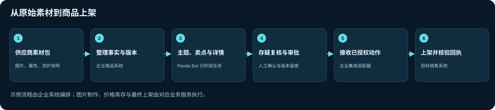
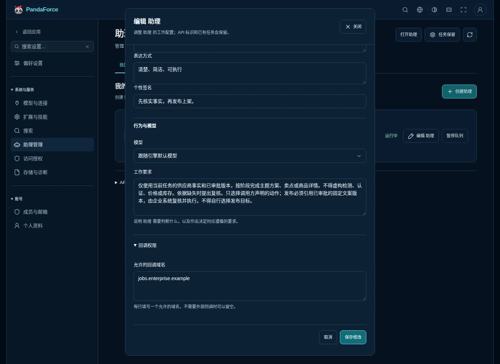
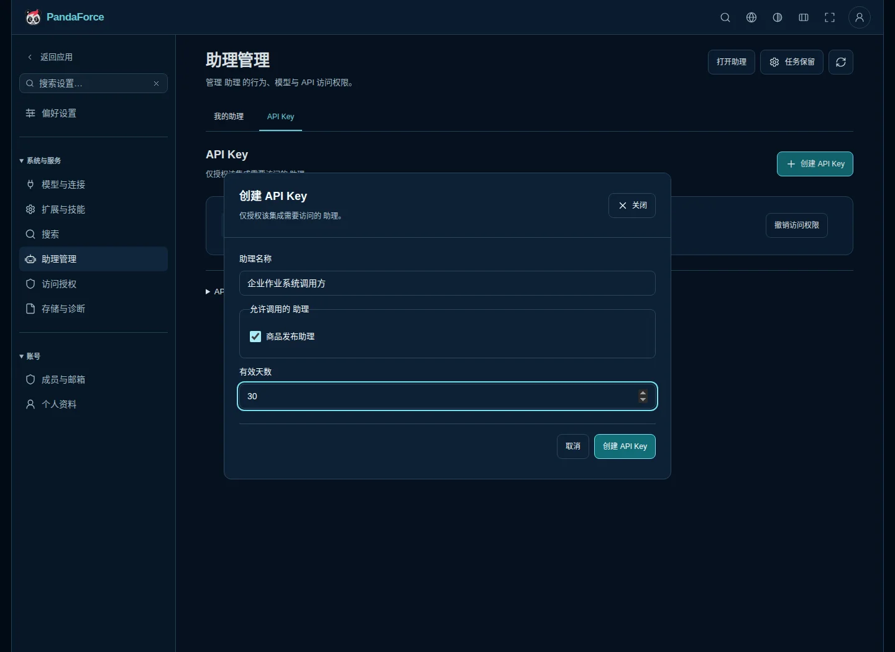
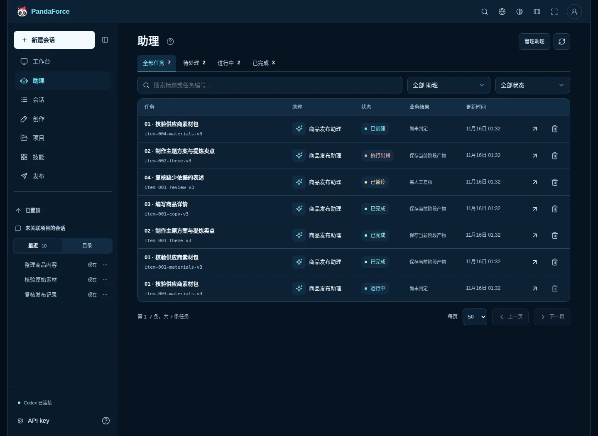
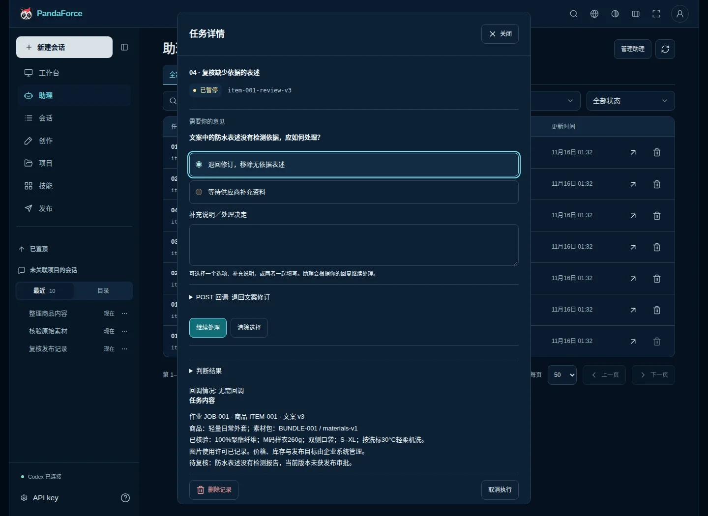
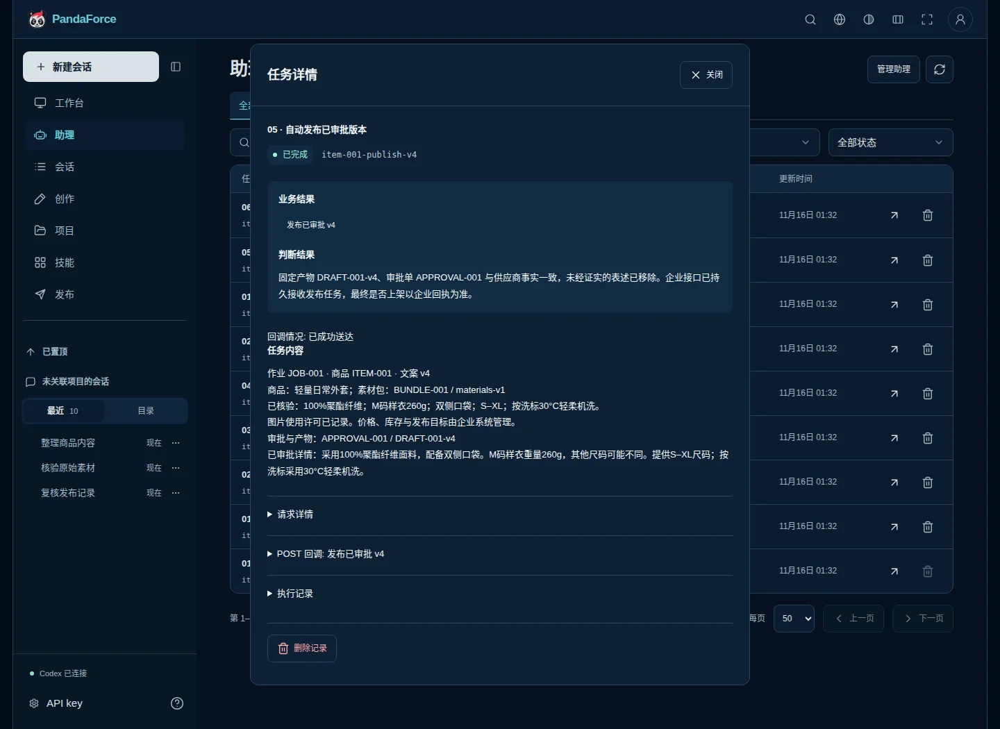
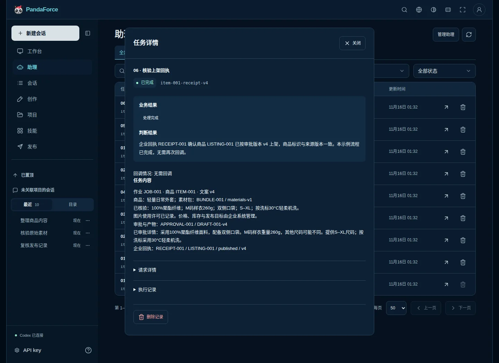
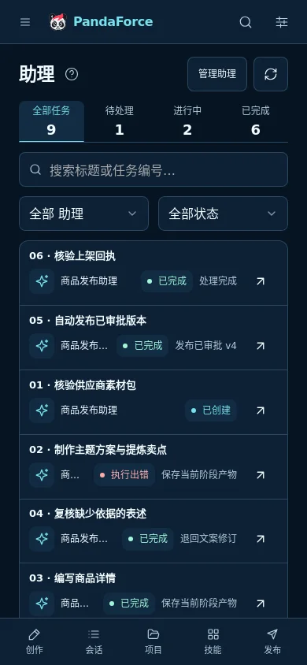

# 从供应商素材包到商品发布上架

这个匿名案例演示 Bot 如何与企业商品系统、作业系统集成。示例商品为一件日常外套，所有系统名称、任务和结果均为虚构演示数据，截图来自真实界面，不代表执行过生产上架。

Panda 负责 AI 任务、人工复核、判断和结果投递；企业应用负责阶段编排、原始素材、设计制作服务、商品资料、价格库存、审批台账及最终上架执行。不依赖任何特定商品品牌或销售渠道。



## 起点：收到供应商原始素材包

供应商交付 `materials-ITEM-001.zip`，包含正反面图片、属性表、尺码表、洗标及图片使用许可。企业素材接收服务解包、校验、保留原件，分配 `BUNDLE-001` 和 `materials-v1`，整理成可核验的事实：

| 来源信息   | 已核验内容             | 使用边界                 |
| ---------- | ---------------------- | ------------------------ |
| 商品       | 轻量日常外套           | 不需要出现商品品牌。     |
| 面料       | 100%聚酯纤维           | 保留供应商原始描述。     |
| 样衣重量   | M码260g                | 不推断所有尺码重量相同。 |
| 口袋、尺码 | 双侧口袋，S–XL         | 不虚构其他功能。         |
| 洗护       | 30°C轻柔机洗           | 保留洗标适用说明。       |
| 防水检测   | 未提供报告             | 不得写入防水卖点。       |
| 图片权利   | 已记录本素材包使用许可 | 保留许可引用。           |

当前 Bot 任务接口接收文本及最多两张 HTTPS 图片地址，不是 ZIP 上传接口。素材解包、文件存储、文字提取等由企业接入服务完成，再传入必要事实、图片及素材引用。Bot 不会自动下载文本中的所有链接，也不会自动解压整个供应商包。

## 第一步：配置商品发布助理

在“设置 → 助理”中创建“商品发布助理”，code 使用 `product-publishing`。选择引擎默认或已配置模型，写清业务约束：

- 只使用当前任务的事实、来源版本及已审批产物。
- 按本阶段要求提供主题方案、有依据的商品卖点或详情草稿。
- 不虚构检测、认证、价格、库存和审批结果。
- 依据缺失时提出具体复核问题。
- 只能选择调用方声明的动作，由企业系统复核权限并执行变更。

如果启用回调，只允许指定企业接口域名。本示例使用占位域名 `jobs.enterprise.example`，接入时须换成自己的受控接口。



为企业调用方创建访问密钥，仅勾选这个助理，设置有效期，例如30天。生成值保存到企业后端的密钥配置中，不放进浏览器页面或源码仓库；后续可以在管理页轮换或撤销。截图只展示授权范围选择，没有生成或显示密钥。



## 第二步：串联六个业务阶段

| 阶段                | Bot 的工作与产物                                      | 企业系统接着做什么                                             |
| ------------------- | ----------------------------------------------------- | -------------------------------------------------------------- |
| 1. 素材核验         | 核对事实、发现缺失依据。                              | 保存核验结果和素材版本。                                       |
| 2. 主题与卖点       | 提出“日常轻行”主题、中性视觉方向和有来源的卖点。      | 调用已有设计、渲染服务，用已授权素材制作实际主题图片。         |
| 3. 商品详情         | 编写标题、卖点、面料、尺码、洗护等章节，关联来源。    | 校验结果，保存固定草稿 `DRAFT-001-v3`，组装预览。              |
| 4. 发布前复核       | 发现防水表述无检测报告，询问退回修订还是等待依据。    | 退回v3，生成修正版v4，并记录 `APPROVAL-001`。                  |
| 5. 自动执行授权发布 | 核对已审批v4，选择任务声明的 `publish_listing` 动作。 | 复核身份、版本、审批、价格库存策略和幂等性，调用既有上架服务。 |
| 6. 核验上架回执     | 将企业回执与商品、审批版本对应。                      | 只有企业上架回执确认后，才把业务作业标记为已发布。             |

这里是企业侧编排与已有 Bot API 的组合，不是内置的六阶段工作流引擎。企业系统确认前一阶段后，才提交依赖它的下一任务；不同商品可以同时处于排队、执行、复核或失败状态。



## 第三步：通过 API 提交带版本的任务

可直接参考[中文请求示例](https://github.com/hiforce/panda-force-free/blob/develop/examples/bots/product-publishing/publish-task.zh-CN.json)和[英文请求示例](https://github.com/hiforce/panda-force-free/blob/develop/examples/bots/product-publishing/publish-task.json)。选择一个语言版本，替换占位接口和运行时单任务凭证，填入自己的真实事实及审批记录。`publish_listing` 是本次任务声明的动作，不是 Panda 内置的全局任务类型。

```http
POST /api/v1/bots/product-publishing/tasks
Authorization: Bearer <BOT_ACCESS_KEY>
Idempotency-Key: <EXTERNAL_TASK_ID>
Content-Type: application/json
```

```json
{
  "title": "05 · 自动发布已审批版本",
  "externalTaskId": "item-001-publish-v4",
  "instructions": "当前阶段：publish。仅依据所附事实，在判断结果中返回简明结构化产物。依据或审批缺失时请求复核。由企业应用编排下一阶段，不得跳步。",
  "input": {
    "text": "{\"productId\":\"ITEM-001\",\"artifactRef\":\"DRAFT-001-v4\",\"approvalRef\":\"APPROVAL-001\",\"unsupportedClaimsRemoved\":true}",
    "images": []
  },
  "actions": [
    {
      "id": "publish_listing",
      "label": "发布已审批 v4",
      "when": "仅当固定 v4 产物、审批单与已核验事实一致时。",
      "callback": {
        "url": "https://jobs.enterprise.example/bot-results/accept",
        "method": "POST",
        "body": {
          "externalTaskId": "item-001-publish-v4",
          "productId": "ITEM-001",
          "stage": "publish",
          "draftVersion": "v4",
          "artifactRef": "DRAFT-001-v4",
          "approvalRef": "APPROVAL-001",
          "receiptProof": "<runtime-per-job-proof>"
        },
        "success": {
          "path": "accepted",
          "equals": true
        }
      }
    }
  ]
}
```

请求内容是数据，传入一个 `approvalRef` 字符串或 AI 判断并不能生成审批。企业后端必须查验真实审批记录及固定产物。上面的简化片段用于说明接口；真实发布检查还需要提供完整事实和已审阅文案，可参照下载示例。

新请求返回HTTP 202和 `task.id`，企业系统将它与业务作业关联保存。相同幂等键、相同内容重放会返回原任务且 `duplicate: true`；同键改动内容会产生冲突。修订文案要使用新的阶段、版本标识。单任务凭证应与请求一并生成并持久保存，重放时凭证及其余请求内容均保持不变。

```http
GET /api/v1/bots/product-publishing/tasks/<TASK_ID>
Authorization: Bearer <BOT_ACCESS_KEY>
```

## 第四步：让人工复核成为发布边界

本例v3存在无依据的防水表述。Bot 给出具体问题和可选处理方式，选择“退回修订”不会授权上架。企业系统另建移除该表述的v4，记录审批后，再提交新的发布任务。

人工可直接选择已声明动作，也可补充说明要求继续分析；带补充限定的回复会重新分析，不会机械执行选项。企业台账持续保存任务、文案版本及审批的对应关系。



## 第五步：把结果交回企业作业系统

选择带回调的动作后，Panda 会发送调用方预设的请求体，并附加 Bot 的 `reason`，以及存在时的 `imageEvidence`。请求使用 `Content-Type: application/json`；本例声明动作的 `Idempotency-Key` 格式为 `panda-bot-<task-id>:<action-id>`。AI 选择动作ID，不自行选择回调接口，也不改写预设请求体。

原生结果字段是**字符串**。如果某阶段把JSON放进 `reason`，企业适配器须解析、校验结构并核对来源及版本后，才能落商品字段。“让模型输出JSON”本身不等于有类型校验的输出。尤其不要直接把模型生成的价格、库存、发布目标或审批信息写进业务记录。

接收适配器应完成：

1. 校验短期单任务凭证，找到对应业务作业和Panda任务。
2. 用受限 Bot Key 读取权威任务，核对助理、动作、来源版本及预期阶段。回调投递期间任务可能仍为 `running`，不能等待 `completed` 才确认，否则会互相等待。
3. 查验真实审批和产物，在持久接收台账中登记幂等标识。
4. 事务性保存或入队后，尽快返回如 `{"accepted":true,"receiptRef":"ACK-001"}` 的小型响应。
5. 企业上架作业完成后保存最终回执。重复投递返回同一回执，不重复创建商品。

当前回调契约不支持任意认证请求头配置，也没有内置HMAC签名。不要把模型供应商密钥或长期管理员凭据放入任务；单任务凭证是企业适配器的约定，不是已实现的原生签名能力。

即便HTTP为2xx，如果响应包含 `success:false`、`ok:false` 或不符合配置的成功断言，仍会视为失败。回调请求限时15秒，因此应确认持久接收，而不是一直等待耗时上架完成。



### 企业接口仅在内网时

最简单的方式可以是**企业主动提交并轮询**：省略动作的 `callback`，由企业后端读取 Bot 任务结果，再在自己的网络内执行已审批操作，无需开放企业入站接口。

当前原生回调只允许白名单内、可解析到公网地址的HTTPS主机，端口为443；私网、回环、链路本地地址和重定向会被拒绝。如果给内网应用使用回调，需要配置兼容的受控边缘适配器，不能为直连内网而关闭地址检查。

## 第六步：管理失败，并核对真正的上架回执

| 状态                        | 含义                               | 操作或适配器处理                           |
| --------------------------- | ---------------------------------- | ------------------------------------------ |
| `queued` / `running`        | 已接收或处理中。                   | 保留输入，不重复提交。                     |
| `review`                    | 缺少依据或需要决策。               | 回答具体问题，必要时创建新版本。           |
| `callback_failed`           | 投递失败或接收断言不满足。         | 查看响应并核对企业接收台账，再决定重试。   |
| `callback_unknown`          | 企业可能已经接收。                 | 先对账，再按幂等方式重放。                 |
| `callbackStatus: succeeded` | 企业适配器接收成功。               | 单凭这个状态不能证明商品已上架。           |
| 明确的上架回执              | 企业确认指定商品及审批版本已发布。 | 完成企业业务作业，可追加一条回执核验任务。 |

下图是虚构企业回执：`LISTING-001` 已按审批版本v4上架。它展示最终确认，与“回调接收成功”分开。





## 复现文档演示

在仓库根目录构建客户端后运行 `bun scripts/release/capture-bot-usecase.mjs`。脚本创建临时账号和隔离状态、签发短期受限密钥，实际走通任务提交、幂等重放和人工复核，再展示虚构结果。未过期的模拟执行阻止后台派发，所以不会调用任何供应商、企业接口或上架服务；结束后撤销临时Key并删除夹具。截图不包含生成的密钥。

本案例只增加文档及演示资料，不代表已交付通用企业连接器、专业图片制作引擎、发布调度器或模型网关与计费系统。

撤销、批量删除及重新生成任务实例的接入方式，参见 [Bot 任务删除与幂等](./bot-task-lifecycle.md)。
